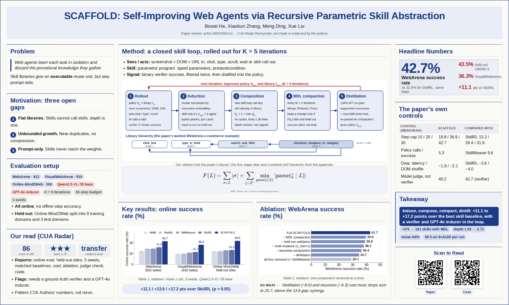
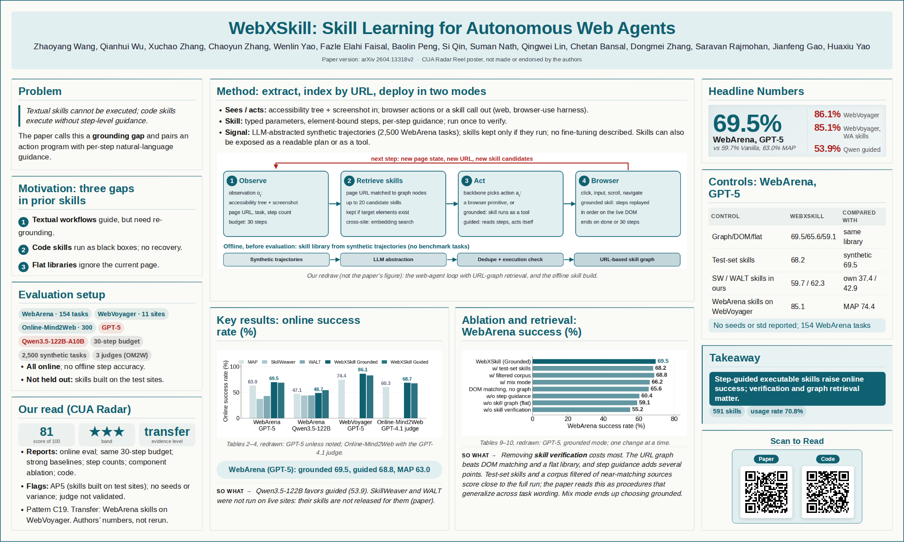
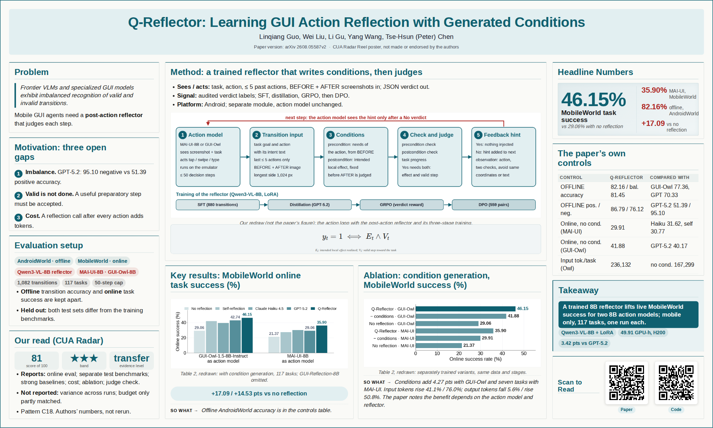
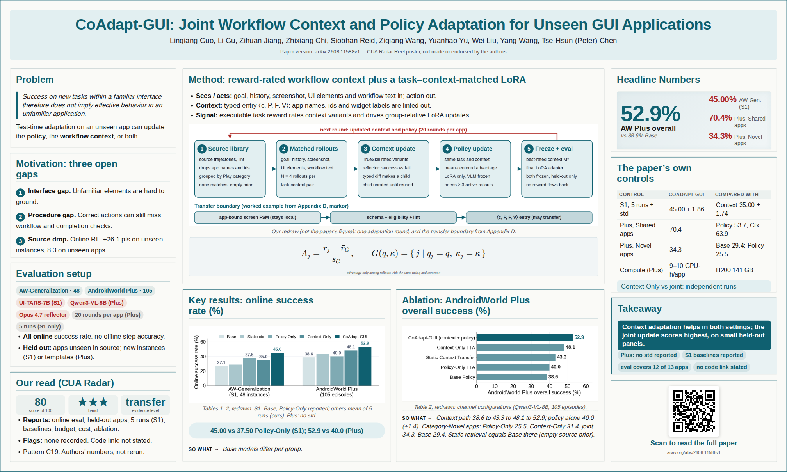
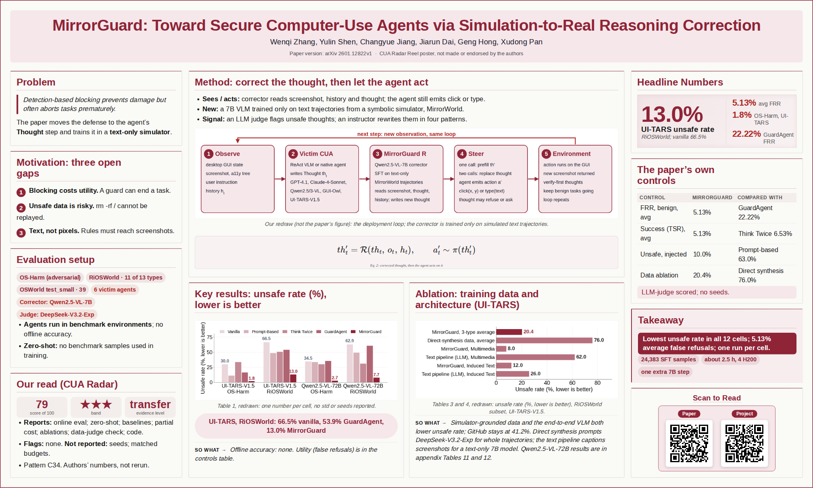
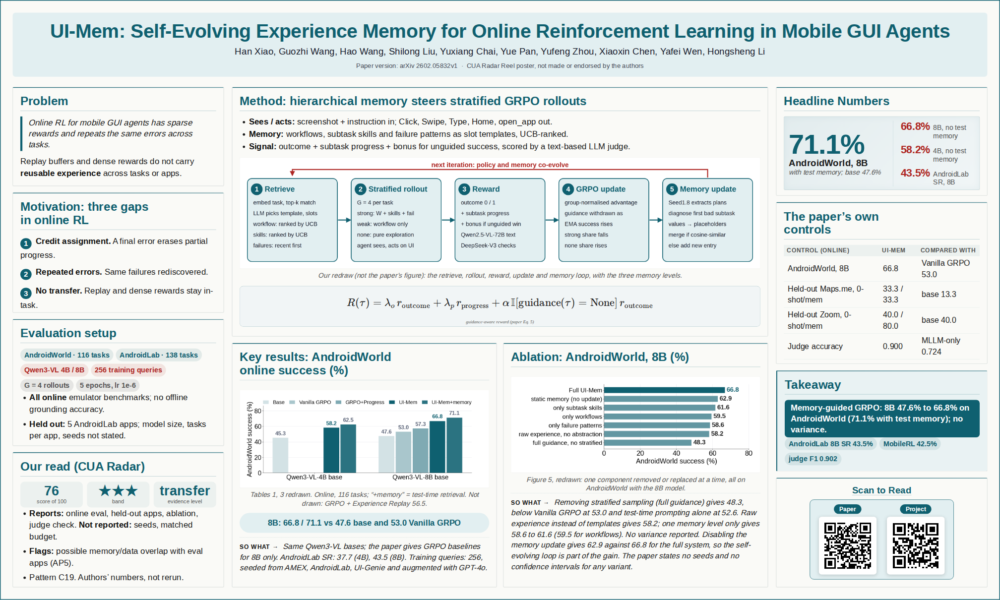
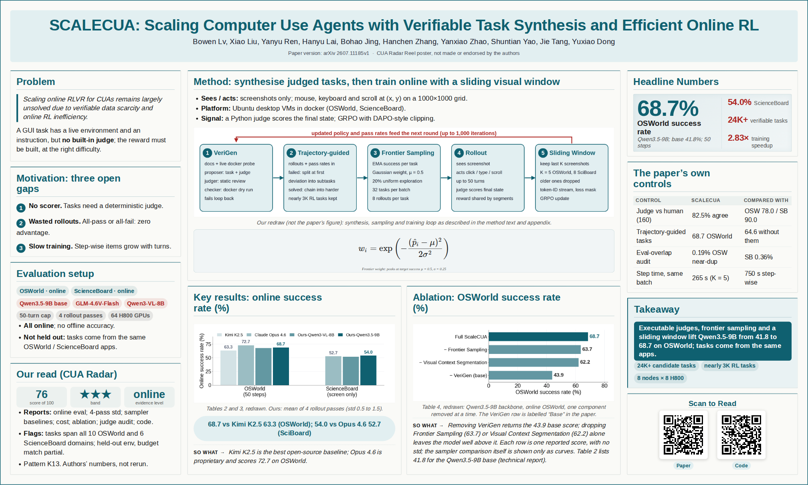
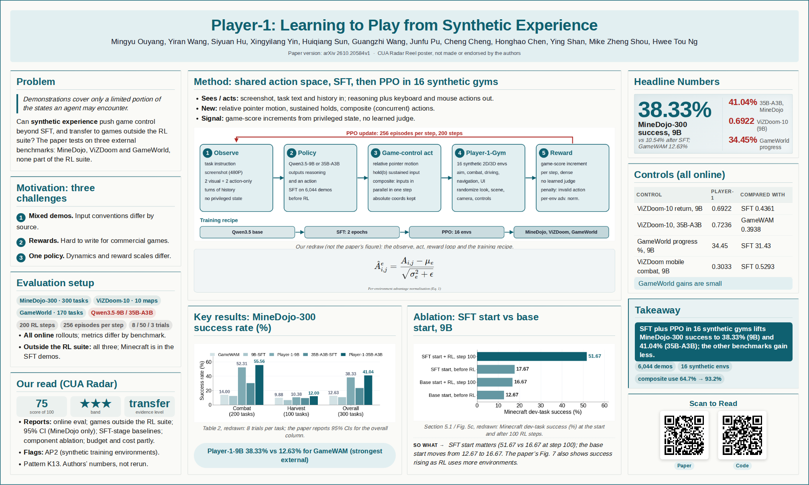
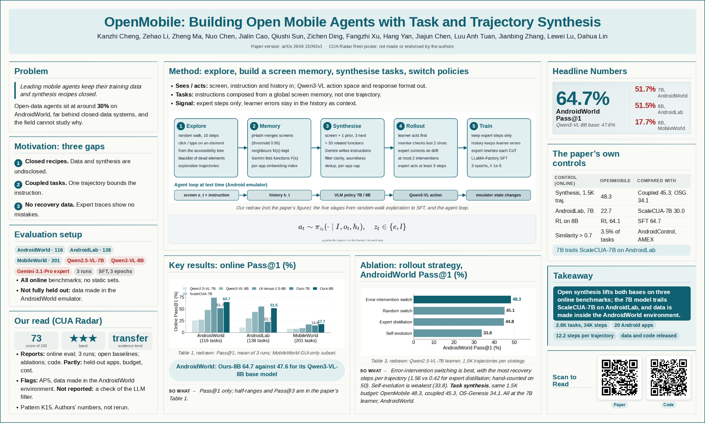

# CUA Radar — Computer Use Architecture Radar

A research radar for **computer-use agents**: systems that perceive and act on graphical or browser interfaces
(desktop, mobile, web) to complete tasks. Paper lists for this field already exist, and this repo is built from seven
of them. It goes the other way: **depth over breadth**. For each paper it asks *which part of the
perceive–plan–act–learn loop the paper changes, which recurring architecture pattern that is, and whether the
evidence (live, execution-checked, held-out, budget-matched) supports the claim*. Every judgment is backed by a verbatim
quote from the paper, and a script, not the model, computes the number.

> 中文简介：专门追踪 Computer-Use / GUI / Browser Agent 的架构设计与评测。不做又一个论文列表，而是把每篇论文归到
> 从全文阅读中归纳出的架构模式卡上，逐项判定它的证据（是否在线可执行评测、是否留出环境、是否同预算对比、验证器是否被校验）
> 与执行质量；每个判定都附原文引用，分数由脚本计算。分数衡量"报告了什么、做得怎样"，不评价想法本身的价值。

**Keywords:** computer-use agents (CUA) · GUI agents · web agents · browser agents · mobile / Android agents · desktop / OS agents · GUI grounding · screen parsing · set-of-mark · planner–grounder · action space design · GUI world models · digital twins · environment simulators · trajectory synthesis · online RL for GUI agents · process reward models · LLM judges / verifiers · OSWorld · AndroidWorld · WebArena · Mind2Web · prompt injection on web agents · arXiv daily · awesome list · 计算机操作智能体 · GUI 智能体 · 网页智能体 · 论文雷达

<!-- REEL:START -->
## Poster gallery (9)

Posters and interpretations of top-scoring papers ([how they are made](reel/README.md)).

<table>
<tr><td align="center" width="33%"> <b>SCAFFOLD</b> · 86 ★★★ <a href="reel/2609.05511/blog_zh.md">中文解读</a> · <a href="reel/2609.05511/blog_en.md">English</a> · <a href="https://arxiv.org/abs/2609.05511v1">paper</a></td><td align="center" width="33%"> <b>WebXSkill</b> · 81 ★★★ <a href="reel/2604.13318/blog_zh.md">中文解读</a> · <a href="reel/2604.13318/blog_en.md">English</a> · <a href="https://arxiv.org/abs/2604.13318v2">paper</a></td><td align="center" width="33%"> <b>Q-Reflector</b> · 81 ★★★ <a href="reel/2608.05587/blog_zh.md">中文解读</a> · <a href="reel/2608.05587/blog_en.md">English</a> · <a href="https://arxiv.org/abs/2608.05587v2">paper</a></td></tr>
<tr><td align="center" width="33%"> <b>CoAdapt-GUI</b> · 80 ★★★ <a href="reel/2608.11588/blog_zh.md">中文解读</a> · <a href="reel/2608.11588/blog_en.md">English</a> · <a href="https://arxiv.org/abs/2608.11588v1">paper</a></td><td align="center" width="33%"> <b>MirrorGuard</b> · 79 ★★★ <a href="reel/2601.12822/blog_zh.md">中文解读</a> · <a href="reel/2601.12822/blog_en.md">English</a> · <a href="https://arxiv.org/abs/2601.12822v1">paper</a></td><td align="center" width="33%"> <b>UI-Mem</b> · 76 ★★★ <a href="reel/2602.05832/blog_zh.md">中文解读</a> · <a href="reel/2602.05832/blog_en.md">English</a> · <a href="https://arxiv.org/abs/2602.05832v1">paper</a></td></tr>
<tr><td align="center" width="33%"> <b>SCALECUA</b> · 76 ★★★ <a href="reel/2607.11185/blog_zh.md">中文解读</a> · <a href="reel/2607.11185/blog_en.md">English</a> · <a href="https://arxiv.org/abs/2607.11185v1">paper</a></td><td align="center" width="33%"> <b>Player-1</b> · 75 ★★★ <a href="reel/2610.20584/blog_zh.md">中文解读</a> · <a href="reel/2610.20584/blog_en.md">English</a> · <a href="https://arxiv.org/abs/2610.20584v1">paper</a></td><td align="center" width="33%"> <b>OpenMobile</b> · 73 ★★★ <a href="reel/2604.15093/blog_zh.md">中文解读</a> · <a href="reel/2604.15093/blog_en.md">English</a> · <a href="https://arxiv.org/abs/2604.15093v1">paper</a></td></tr>
</table>
<!-- REEL:END -->

<!-- BOARD:START -->
## Top 30 papers by CUA Radar score

Out of 568 scored so far (25 at ★★★ ≥ 70). Full board, grouped by pattern: [papers/](papers/README.md). Score (0–100) = **E**vidence (50) + e**X**ecution against the pattern card (30) + evidence **L**evel (10) + **C**ode (10); every judgment is quote-backed — see [SCORE_SPEC](research/SCORE_SPEC.md). It measures what a paper reports and how it executes its move, not the value of the idea.

| Date | Paper | Pattern | Score | Code |
|---|---|---|---|---|
| 2026-08-31 | **[SCAFFOLD: Self-Improving Web Agents via Recursive Parametric Skill Abstraction](https://arxiv.org/abs/2609.05511v1)** SCAFFOLD：通过递归参数化技能抽象实现自我改进的网页智能体 Induces recursive parametric skills from own successes, MDL-compacts the library and distils into weights; WebArena 42.7, held-out Online-Mind2Web sites 43.5. | [C19](patterns/sub/C19.md) | **86** ★★★ E50 X16 L10 C10 | [code](https://github.com/BokwaiHo/SCAFFOLD) |
| 2026-04-14 | **[WebXSkill: Skill Learning for Autonomous Web Agents](https://arxiv.org/abs/2604.13318v2)** WebXSkill：自主网页智能体的技能学习 Executable skills with step guidance mined from synthetic trajectories, retrieved via a URL graph; gains on WebArena and live sites, cross-site transfer, component ablations. | [C19](patterns/sub/C19.md) | **81** ★★★ E35 X26 L10 C10 | [code](https://github.com/aiming-lab/WebXSkill) |
| 2026-08-06 | **[Q-Reflector: Learning GUI Action Reflection with Generated Conditions](https://arxiv.org/abs/2608.05587v2)** Q-Reflector：借助生成的前后置条件学习 GUI 动作反思 Trained 8B post-action reflector generates pre/post-conditions then judges before/after screenshots; validated on labelled transitions, lifts live MobileWorld success for two policies. | [C18](patterns/sub/C18.md) | **81** ★★★ E41 X20 L10 C10 | [code](https://github.com/pockyitachi/Q-Reflector) |
| 2026-08-12 | **[CoAdapt-GUI: Joint Workflow Context and Policy Adaptation for Unseen GUI Applications](https://arxiv.org/abs/2608.11588v1)** CoAdapt-GUI：面向未见GUI应用的工作流上下文与策略联合自适应 Test-time adaptation on unseen apps jointly evolves a reward-rated workflow context and a LoRA policy from own rollouts; held-out apps and templates, multi-run. | [C19](patterns/sub/C19.md) | **80** ★★★ E48 X22 L10 C0 | — |
| 2026-01-19 | **[MirrorGuard: Toward Secure Computer-Use Agents via Simulation-to-Real Reasoning Correction](https://arxiv.org/abs/2601.12822v1)** MirrorGuard：通过仿真到现实的推理纠正实现安全的计算机使用智能体 A 7B corrector trained on text-simulated risky trajectories rewrites unsafe thoughts before actions; lowers unsafe rates on OS-Harm/RiOSWorld across six CUAs with low false refusals. | [C34](patterns/sub/C34.md) | **79** ★★★ E36 X23 L10 C10 | — |
| 2026-02-05 | **[UI-Mem: Self-Evolving Experience Memory for Online Reinforcement Learning in Mobile GUI Agents](https://arxiv.org/abs/2602.05832v1)** UI-Mem：面向移动 GUI 智能体在线强化学习的自演化经验记忆 Hierarchical templated memory (workflows, skills, failure patterns) guides stratified GRPO rollouts and inference; AndroidWorld 8B 47.6% to 71.1%, gains on five held-out apps. | [C19](patterns/sub/C19.md) | **76** ★★★ E36 X20 L10 C10 | — |
| 2026-07-13 | **[SCALECUA: Scaling Computer Use Agents with Verifiable Task Synthesis and Efficient Online RL](https://arxiv.org/abs/2607.11185v1)** SCALECUA：以可验证任务合成与高效在线 RL 扩展计算机使用智能体 Synthesises 3K verifiable RL tasks with container-tested judges, frontier task sampling and sliding visual window; OSWorld 68.7% over 4 passes, with component ablations. | [K13](patterns/sub/K13.md) | **76** ★★★ E43 X17 L6 C10 | [code](https://github.com/THUDM/SCALE-CUA) |
| 2026-10-01 | **[GUI-HARVEST: Self-Improving GUI Agents through Evidence-Driven Harness Evolution](https://arxiv.org/abs/2610.00948v1)** GUI-HARVEST：通过证据驱动的执行框架演化实现自我改进的GUI智能体 Evolves the executable harness around a frozen GUI model from repeated multimodal runs; held-out OSWorld-Verified gains on six backbones and WAA transfer. | [C19](patterns/sub/C19.md) | **76** ★★★ E41 X15 L10 C10 | [code](https://github.com/GaryYang12345/GUI-HARVEST) |
| 2026-10-14 | **[Player-1: Learning to Play from Synthetic Experience](https://arxiv.org/abs/2610.20584v1)** Player-1：从合成经验中学习玩游戏 Extends CUA action space for games, SFT on demos, then PPO in 16 synthetic reward-verified gyms; MineDojo 10.5->38.3%, gains transfer to ViZDoom/GameWorld. | [K13](patterns/sub/K13.md) | **75** ★★★ E43 X12 L10 C10 | [code](https://github.com/TencentARC/Player-1) |
| 2026-10-15 | **[OS-Helix: Unifying GUI Interaction and Code Execution in Native Computer-Using Agents](https://arxiv.org/abs/2610.22234v1)** OS-Helix：在原生计算机使用智能体中统一GUI交互与代码执行 End-to-end policy with unified GUI/code actions, trained on artifact-composed synthesized verifiable tasks plus step-balanced GSPO; OSWorld-Verified 66.44%, transfers to WAA. | [C11](patterns/sub/C11.md) | **75** ★★★ E47 X8 L10 C10 | [code](https://github.com/OS-Copilot/OS-Helix) |
| 2026-03-11 | **[Safe and Scalable Web Agent Learning via Recreated Websites](https://arxiv.org/abs/2603.10505v1)** 通过重建网站实现安全且可扩展的网页智能体学习 Coding agent clones 149 real sites with backend and SDK; executable task validators give deterministic rewards for rejection fine-tuning; gains on held-out WebArena, Mind2Web-Online. | [K13](patterns/sub/K13.md) | **74** ★★★ E34 X20 L10 C10 | [code](https://github.com/kyle8581/VeriEnv) |
| 2026-01-13 | **[ExpSeek: Self-Triggered Experience Seeking for Web Agents](https://arxiv.org/abs/2601.08605v2)** ExpSeek：面向网页智能体的自触发经验检索 Entropy-triggered step-level guidance generated from a mistake-triplet experience base for search web agents; +9.3/+7.5 on four web QA benchmarks, five runs, LLM-judged. | [K27](patterns/sub/K27.md) | **73** ★★★ E38 X19 L6 C10 | [code](https://github.com/WYRipple/ExpSeek) |
| 2026-04-16 | **[OpenMobile: Building Open Mobile Agents with Task and Trajectory Synthesis](https://arxiv.org/abs/2604.15093v1)** OpenMobile：通过任务与轨迹合成构建开放移动智能体 Synthesises mobile tasks from an exploration-built screen memory and collects error-recovery trajectories by learner-expert switching; SFT reaches 51.7/64.7% AndroidWorld, with overlap analysis. | [K15](patterns/sub/K15.md) | **73** ★★★ E38 X15 L10 C10 | [code](https://github.com/njucckevin/OpenMobile-Code) |
| 2026-04-23 | **[VLAA-GUI: Knowing When to Stop, Recover, and Search, A Modular Framework for GUI Automation](https://arxiv.org/abs/2604.21375v3)** VLAA-GUI：知道何时停止、恢复与搜索的模块化GUI自动化框架 Prompted desktop framework adds a criteria-plus-judge completion verifier, tiered loop breaker and text search agent; 77.5% OSWorld-Verified, 61.0% WAA, with per-component ablations. | [C18](patterns/sub/C18.md) | **73** ★★★ E40 X13 L10 C10 | [code](https://github.com/UCSC-VLAA/VLAA-GUI) |
| 2026-10-01 | **[Not All Experience Belongs in the Weights: Component Routing for Self-Improving GUI Agents](https://arxiv.org/abs/2610.01787v1)** 并非所有经验都应写入权重：自我改进GUI智能体的组件路由 Splits an agent's own experience into locators, procedures, state facts and lessons, routing each to context or weights; checker-scored held-out apps, three backbones and seeds. | [K27](patterns/sub/K27.md) | **73** ★★★ E38 X22 L10 C3 | — |
| 2025-05-20 | **[Efficient Agent Training for Computer Use](https://arxiv.org/abs/2505.13909v2)** 面向计算机使用的高效智能体训练 Augments 312 human Windows trajectories with Claude-reconstructed thoughts and alternative actions, SFTs Qwen2.5-VL-72B; online WindowsAgentArena-V2 gains, OSWorld transfer. | [C21](patterns/sub/C21.md) | **72** ★★★ E42 X10 L10 C10 | [code](https://github.com/GAIR-NLP/PC-Agent-E) |
| 2025-05-22 | **[GUI-explorer: Autonomous Exploration and Mining of Transition-aware Knowledge for GUI Agent](https://arxiv.org/abs/2505.16827v1)** GUI-explorer：面向GUI智能体的自主探索与转移感知知识挖掘 Training-free agent explores apps with manifest-anchored goals, mines action-effect knowledge from transitions, retrieves it per step; AndroidWorld 47.4%, SPA-Bench 53.7%. | [C19](patterns/sub/C19.md) | **72** ★★★ E34 X22 L6 C10 | [code](https://github.com/JiuTian-VL/GUI-explorer) |
| 2026-03-04 | **[Dual-Modality Multi-Stage Adversarial Safety Training: Robustifying Multimodal Web Agents Against Cross-Modal Attacks](https://arxiv.org/abs/2603.04364v2)** 双模态多阶段对抗安全训练：增强多模态网页智能体抵御跨模态攻击的能力 Hardens a web agent against DOM injections hitting screenshot and a11y tree via imitation, oracle-guided SFT and GRPO attacker-agent self-play; held-out MiniWob++ and VisualWebArena. | [C34](patterns/sub/C34.md) | **72** ★★★ E32 X20 L10 C10 | [code](https://github.com/huajianduzhuo-code/DMAST_official) |
| 2025-09-18 | **[ScaleCUA: Scaling Open-Source Computer Use Agents with Cross-Platform Data](https://arxiv.org/abs/2509.15221v2)** ScaleCUA：利用跨平台数据扩展开源计算机使用智能体 Cross-platform data pipeline (random-walk plus expert trajectories, A11y/DOM grounding) and unified action space train screenshot agents; online evaluation on five live benchmarks. | [C12](patterns/sub/C12.md) | **71** ★★★ E29 X22 L10 C10 | [code](https://github.com/OpenGVLab/ScaleCUA) |
| 2025-11-08 | **[SynthAgent: Adapting Web Agents with Synthetic Supervision](https://arxiv.org/abs/2511.06101v3)** SynthAgent：以合成监督适配网页智能体 Synthesises web tasks from categorized exploration, refines tasks on observed conflicts and trajectories post hoc, SFTs 7B agents; gains on WebArena and Online-Mind2Web. | [K14](patterns/sub/K14.md) | **71** ★★★ E39 X12 L10 C10 | [code](https://github.com/aiming-lab/SynthAgent) |
| 2026-02-25 | **[GUI-Libra: Training Native GUI Agents to Reason and Act with Action-aware Supervision and Partially Verifiable RL](https://arxiv.org/abs/2602.22190v2)** GUI-Libra：以动作感知监督与部分可验证强化学习训练能推理与行动的原生 GUI 智能体 Curated 81K reasoning data, action-weighted SFT and KL-regularised step-wise GRPO under partial verifiability; online gains on AndroidWorld, WebArena-Lite-v2, Online-Mind2Web. | [R01](patterns/sub/R01.md) | **71** ★★★ E31 X20 L10 C10 | [code](https://github.com/GUI-Libra/GUI-Libra) |
| 2026-08-23 | **[CausalCache: Conditional High-Fidelity Restoration for Long-Horizon GUI Agents](https://arxiv.org/abs/2608.22577v2)** CausalCache：面向长程GUI智能体的条件式高保真恢复 Text history plus a learned selector restoring which past screenshots fill a fixed image budget; desktop-trained, zero-shot MobileWorld 30.2%->36.8%. | [C15](patterns/sub/C15.md) | **71** ★★★ E48 X13 L10 C0 | — |
| 2026-01-09 | **[From Off-Policy to On-Policy: Enhancing GUI Agents via Bi-level Expert-to-Policy Assimilation](https://arxiv.org/abs/2601.05787v2)** 从离策略到在策略：通过双层专家到策略同化增强 GUI 智能体 Re-rolls expert plans under the base policy and caches own successes, injected into GRPO on total group failure; OSWorld-Verified 22.87 -> 32.13 (3 runs). | [K20](patterns/sub/K20.md) | **70** ★★★ E39 X15 L6 C10 | [code](https://github.com/LEON-gittech/Verl_GUI.git) |
| 2026-01-22 | **[EvoCUA: Evolving Computer Use Agents via Learning from Scalable Synthetic Experience](https://arxiv.org/abs/2601.15876v2)** EvoCUA：通过可扩展合成经验学习演化的计算机使用智能体 Co-generates desktop tasks with executable validators, rolls out at scale in sandboxes, and iterates RFT plus failure-derived DPO; OSWorld 56.7% at 32B, staged ablations. | [K13](patterns/sub/K13.md) | **70** ★★★ E37 X17 L6 C10 | [code](https://github.com/meituan/EvoCUA) |
| 2026-10-16 | **[Adaptation of Computer Use Agents to New Software with User Manuals](https://arxiv.org/abs/2610.23012v1)** 借助用户手册使计算机使用智能体适配新软件 Retrieves user-manual sections into a planner's procedural plan and trains the CUA with GRPO on manual-derived tasks; OSWorld apps 36.8->47.3% (UI-TARS-1.5). | [K28](patterns/sub/K28.md) | **70** ★★★ E42 X12 L6 C10 | [code](https://github.com/ku-autoai/MAGE) |
| 2025-08-12 | **[OpenCUA: Open Foundations for Computer-Use Agents](https://arxiv.org/abs/2508.09123v3)** OpenCUA：计算机使用智能体的开放基础 Collects 22.6K cross-OS human desktop demos, synthesises reflective long CoT per step and SFTs screenshot policies; OpenCUA-72B reaches 45.0% on OSWorld-Verified. | [C21](patterns/sub/C21.md) | **69** ★★ E43 X10 L6 C10 | [code](https://github.com/xlang-ai/OpenCUA) |
| 2025-10-17 | **[PolySkill: Learning Generalizable Skills Through Polymorphic Abstraction](https://arxiv.org/abs/2510.15863v2)** PolySkill：通过多态抽象学习可泛化技能 Induces code skills as abstract domain classes with site-specific implementations from own successful runs; improves skill reuse and success on held-out websites over ASI/SkillWeaver. | [C19](patterns/sub/C19.md) | **69** ★★ E38 X11 L10 C10 | [code](https://github.com/simonucl/PolySkill) |
| 2026-05-28 | **[Recovering Policy-Induced Errors: Benchmarking and Trajectory Synthesis for Robust GUI Agents](https://arxiv.org/abs/2605.29447v1)** 恢复策略诱发错误：面向鲁棒GUI智能体的基准与轨迹合成 Tree-based synthesis branches from fragile states and replays error states for advice-conditioned recovery; 800K SFT steps lift OSWorld to 47.4%, plus GUI-RobustEval benchmark. | [K26](patterns/sub/K26.md) | **69** ★★ E40 X13 L6 C10 | [code](https://github.com/AlibabaResearch/RoTS) |
| 2026-06-08 | **[AliyunConsoleAgent: Training Web Agents in Real-World Cloud Environments via Distillation and Reinforcement Learning](https://arxiv.org/abs/2606.09447v1)** AliyunConsoleAgent：在真实云环境中通过蒸馏与强化学习训练网页智能体 SFT-then-GRPO 32B console agent with audit-log rule rewards and provisioned real cloud accounts; 278 live tasks, 3 runs, 63.52%. | [K12](patterns/sub/K12.md) | **69** ★★ E43 X10 L6 C10 | [code](https://github.com/AlibabaResearch/aliyun-console-agent) |
| 2026-08-29 | **[Learning Simple Test-Time Environments for LLM Web Agents](https://arxiv.org/abs/2608.29305v1)** 为 LLM 网页智能体学习简单的测试时环境 Agent decomposes observations into sub-goals and pruned sub-observations, adapted by self-assessed test-time RL; WebArena 12.1->21.0, WorkArena transfer. | [C13](patterns/sub/C13.md) | **69** ★★ E44 X5 L10 C10 | [code](https://github.com/THUNLP-MT/TTED) |
<!-- BOARD:END -->

## What is here

| Path | What |
|---|---|
| [`papers/`](papers/README.md) | **Paper board**: every scored paper, grouped by main pattern, with Chinese title, one-line summary, score breakdown and code link |
| [`patterns/`](patterns/overview.md) | **Architecture pattern cards**: 18 [main patterns](patterns/main/) grouping 75 [sub-patterns](patterns/sub/) (K01–K35, C01–C37, R01–R03), plus 22 [anti-patterns](patterns/anti-patterns.md) |
| [`cards/`](cards/) | Per-paper **diagnosis cards** (template only so far): mechanism, author-reported evidence, our diagnosis, code check at a pinned SHA |
| [`docs/EVIDENCE.md`](docs/EVIDENCE.md) | Scope (tier A/B) and the offline / online / transfer evidence levels |
| [`docs/PIPELINE.md`](docs/PIPELINE.md) · [`docs/agents/`](docs/agents/ROLES.md) | How new papers flow in (collector → inbox → ingest → screen → full text → assign + judge → score → board), and the prompts for the collector and scorer agents |
| [`inbox/`](inbox/README.md) | Candidate papers waiting to be processed |
| [`docs/MAINTAINING.md`](docs/MAINTAINING.md) | Maintenance rules for agents and humans |
| [`research/`](research/) | The reproducible pipeline and its data; the build log is [`research/PIPELINE.md`](research/PIPELINE.md) |
| `main.py`, `src/` | Daily arXiv fetch + LLM relevance scoring, inherited from [daily_arxiv_digest](https://github.com/yang3kc/daily_arxiv_digest) ([usage](docs/digest-pipeline.md)); topics in `config.example.json`, search terms and anchor works in `keywords.json` |

## How it was built

1. **Corpus.** Every arXiv paper cited by 7 public computer-use / GUI-agent / web-agent lists (credited below):
   **2,707 papers** (`research/corpus.jsonl`). The lists contribute arXiv ids and the section a curator filed each
   paper under. Nothing else is taken from them.
2. **Screening** from title + abstract ([`SCREEN_RUBRIC.md`](research/SCREEN_RUBRIC.md)): tier A (a computer-use
   agent method or system), B (a direct contribution to the field: benchmark, grounding data, judge, safety or
   empirical study), C (out of scope). Result: **A 689 / B 616 / C 1,402**, of which 165 are automatic C because the
   primary arXiv category lies outside cs / stat.ML / eess (`research/screen.jsonl`).
3. **Pattern cards.** Two [Open Scientist](#credits-and-license) domain builds (`cua-agents/v1` and
   `cua-agents-core/v1`), each from **40 papers read in full**, produced sub-patterns K01–K35 and C01–C37. Three more
   (R01–R03) were induced from the weak fits of the first scoring wave (32 of 100 papers). Together they form
   **18 main patterns**, each with numbered success conditions and failure modes, plus **anti-patterns AP1–AP22**. No
   outcome labels exist in this build, so the cards hold no accept rates. Success conditions and failure modes come from
   the readings.
4. **First board.** Tier A papers published in 2025 or later: **568 papers** (`research/board1_ids.txt`). The other
   737 A/B papers wait in `research/queue/2026-10-19-backlog.txt`.
5. **Assign + judge** ([`docs/agents/JUDGE_BATCH.md`](docs/agents/JUDGE_BATCH.md)). For each paper, from its full
   text only: pick one sub-pattern (`fit: good|weak`), then fill a judgment record against that pattern's conditions,
   the 9 evidence items and every anti-pattern. Every non-`unclear` value carries a verbatim quote of ≤45 words.
6. **Score** (`research/score.py`). The script rejects any quote that does not occur in the paper text, then computes
   the number. Anyone can rerun the same judgment and get the same arithmetic.

Build state, counts and what is still to do: [`research/PIPELINE.md`](research/PIPELINE.md).

## The score

Full definition: [`research/SCORE_SPEC.md`](research/SCORE_SPEC.md) and
[`research/EVIDENCE_SCHEMA.md`](research/EVIDENCE_SCHEMA.md). Score (0–100) =

| part | max | what it checks |
|---|---|---|
| **Evidence** | 50 | the 9 reviewer expectations of the field: online, execution-checked evaluation (10) · held-out apps/sites/environments (8) · variance over ≥3 runs (6) · strong baselines at matched backbone size (8) · matched step/candidate/token budget (6) · cost reported (4) · ablation of the key component (4) · validation of any learned judge, reward model, world model or twin (4) |
| **Execution** | 30 | against the paper's main pattern: 20 × share of success conditions met + 10 × share of failure modes avoided; −5 per unmitigated anti-pattern (cap 10; AP7–AP9 and AP17 are recorded but not penalised, since evidence items already price them) |
| **Evidence level** | 10 | transfer 10 · online 6 · offline 2 (definitions in [`docs/EVIDENCE.md`](docs/EVIDENCE.md)) |
| **Code** | 10 | a code URL found in the paper, the arXiv comment, the verified anchors or Hugging Face Papers · announced 3 |

Bands: ≥70 ★★★ · 50–69 ★★ · 30–49 ★ · <30 —.

**What the score is not.** It measures what a paper *reports* and how well it *executes* its architecture move. It is
not a verdict on the value of the idea and not a prediction of acceptance. A strong idea with offline-only evidence
scores low here. Venue, citations, GitHub stars and author reputation never enter it. The evidence weights follow
what the field's reviewers ask for most often (live execution-checked evaluation, held-out environments, matched
baselines), as derived by Open Scientist from the full-text readings.

**Repo Score (planned, separate).** Whether a paper's code actually runs and reproduces is a separate Repo Score. It is
not built yet and will never be mixed into this number.

## Caveats

- Screening, pattern assignment and judgments are LLM-produced. Quotes are verified mechanically, but whether a
  quote *justifies* its value is a model judgment. Read the quote before trusting a cell.
- Full texts are condensed arXiv HTML (abstract, intro, method, experiments, limitations). Evidence that sits in a
  cut part is scored `unclear`, not guessed. Papers without an HTML rendering are judged from the abstract and score
  low on evidence for that reason alone.
- The pattern cards come from 80 full-text readings. A paper with `fit: weak` is still judged against the closest
  card, so its execution part is less informative.
- About 28% of board papers have `fit: weak`, rising for 2026 papers (bundled training recipes, guardrail models,
  routing): the taxonomy needs a revision pass ([open issues](research/PIPELINE.md#known-issues-open)).
- Five papers have no HTML full text; they are listed but not ranked.
- Calibration so far is self-consistency only (a blind re-judge of 3 gold papers by a fresh agent: Δ 0 / −2 / −4,
  [details](research/calibration/README.md)), not agreement with a different model or a human.
- Paper full texts are used locally and are not redistributed here.

## Sister projects

| project | question |
|---|---|
| [HarnessRSI Daily](https://github.com/CrepuscularIRIS/HarnessRSI-Daily) | how agents improve themselves (non-weight self-improvement loops) |
| **CUA Radar** (this repo) | how to design and evaluate computer-use agent architectures |
| PetBattleTwin (planned) | how to calibrate a digital twin of a black-box game from real interaction |

## Credits and license

MIT (see [LICENSE](LICENSE)).
- **Base pipeline** cloned from [HarnessRSI Daily](https://github.com/CrepuscularIRIS/HarnessRSI-Daily), itself built
  on [yang3kc/daily_arxiv_digest](https://github.com/yang3kc/daily_arxiv_digest) (MIT).
- **Pattern induction** with the Open Scientist plugin (domain builds in `.forge/domains/`).
- **Corpus sources** (arXiv ids and section headings only):
  [OSU-NLP-Group/GUI-Agents-Paper-List](https://github.com/OSU-NLP-Group/GUI-Agents-Paper-List) ·
  [reacher-z/Awesome-CUA](https://github.com/reacher-z/Awesome-CUA) ·
  [showlab/Awesome-GUI-Agent](https://github.com/showlab/Awesome-GUI-Agent) ·
  [trycua/acu](https://github.com/trycua/acu) ·
  [ranpox/awesome-computer-use](https://github.com/ranpox/awesome-computer-use) ·
  [ZJU-REAL/Awesome-GUI-Agents](https://github.com/ZJU-REAL/Awesome-GUI-Agents) ·
  [steel-dev/awesome-web-agents](https://github.com/steel-dev/awesome-web-agents).
