# CUA-Daily

**A daily radar for GUI / computer-use agents**: models that read a screen and drive a phone, a browser or a desktop through clicks, keystrokes, element ids or code.
（GUI / computer-use agent 雷达：追踪“模型看屏幕、操作手机/浏览器/桌面”的一手研究。）

Core question: *which link of perception → planning → action → feedback does the work change, is the online task actually completed, and where does the gain come from?* Scope and evidence levels: [EVIDENCE](docs/EVIDENCE.md).
（核心问题：改变了感知—规划—动作—反馈中的哪一环，在线任务是否真的完成，提升来自哪里？）

> Current run: `gui-pc11-20261022-01` · rules `problem-core-v1.1` · 1331 papers screened at L1, 1311 checked at L2 (98%), 591 L3 candidates (563 P3 / 28 P2), 22 posters in Reel (3 from rolling run `gui-rolling-20261023-01`). The ratings rank reading priority. They are not peer review and do not endorse any venue.
> （档位是“值不值得读”的判断，不是审稿结论。）

**What this project adds.** （本项目的三点贡献）

1. **18 main / 75 sub pattern cards** reverse-engineered from this corpus, not taken from a preset taxonomy. （18 张主卡、75 张子卡，全部从本语料逆向归纳。）
2. **Two-layer evaluation over the entire in-scope corpus**: L1 abstract + introduction screening → L2 full-text confirmation with sub-card condition checks. （两层评估覆盖全部在范围论文：L1 摘要＋引言初筛 → L2 全文核对＋子卡条件检查。）
3. **19 Reel posters**, each with a distinct layout skeleton, all verified against the source paper by Opus 5.5. （19 张 Reel 海报，版式骨架互不相同，均经 Opus 5.5 对照原文核对。）

## Featured Reel（精选画报）

Nineteen papers, **19 distinct layouts**, shown as one wall. Order: papers from the last three months (Aug–Oct 2026) first, then everything else from newest to oldest. Each poster was checked against the paper's full text by Opus 5.5 and passed visual QA; numbers are mapped to sections and tables in `reel/<id>/SOURCE.md`. Poster checking produced 9 correction records (`batches/l19–l23-correction.jsonl` + selection2 errata); 2307.13854 was moved down to P2 and kept on editorial grounds (P2*). Selection logs: [selection](research/scoring/runs/gui-pc11-20261022-01/selection.md) · [selection2](research/scoring/runs/gui-pc11-20261022-01/selection2.md) · [selection3](research/scoring/runs/gui-pc11-20261022-01/selection3.md) · [Reel index](reel/README.md).
（十九篇十九种版式，统一一面墙：近三个月（2026 年 8–10 月）的论文在前，其余按时间倒序。画报核对产生修订记录，WebArena 降为 P2 后按编辑理由保留。）

<table>
<tr>
<td width="33%" align="center" valign="top">
<a href="reel/2609.02154/poster.png">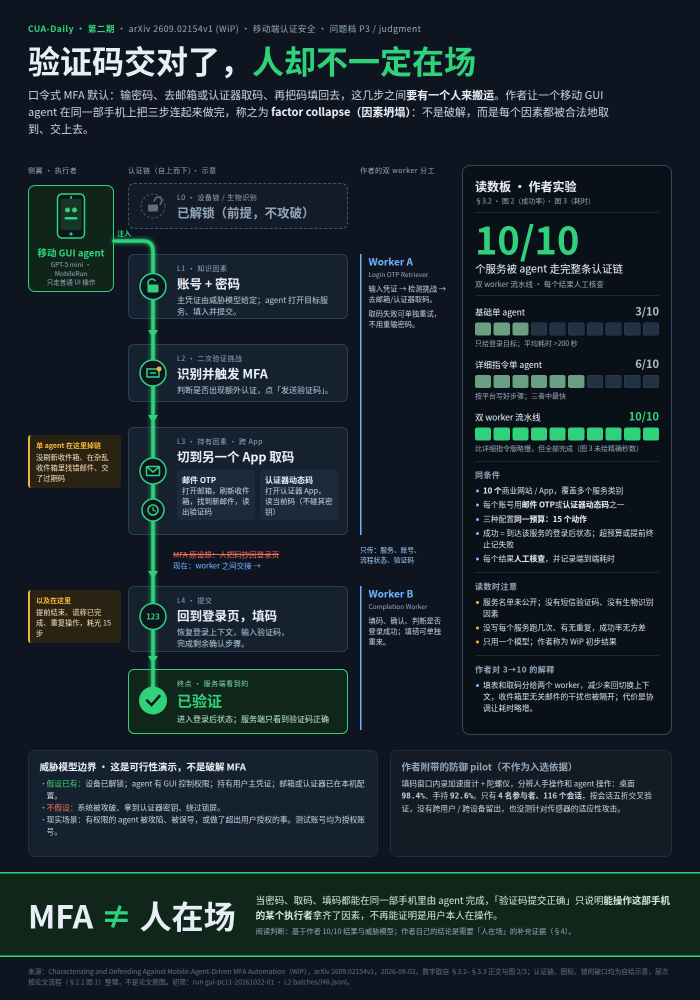</a> 
<b><a href="https://arxiv.org/abs/2609.02154">2609.02154</a> · MFA automation (WiP)</b> 
On an unlocked phone, an agent chains legitimate factors through MFA for up to 10/10 services. 
MFA 完成不再能证明人在场。
</td>
<td width="33%" align="center" valign="top">
<a href="reel/2606.12666/poster.png">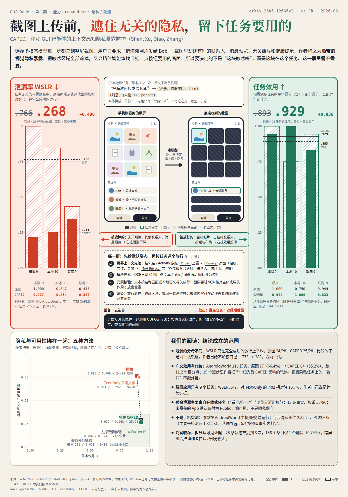</a> 
<b><a href="https://arxiv.org/abs/2606.12666">2606.12666</a> · Privacy masking (CAPED)</b> 
Mask task-irrelevant private content before a screenshot is uploaded: leakage .766 → .268, utility .893 → .929. 
截图上传前遮蔽无关隐私，泄漏率降、效用不降。
</td>
<td width="33%" align="center" valign="top">
<a href="reel/2604.04918/poster.png">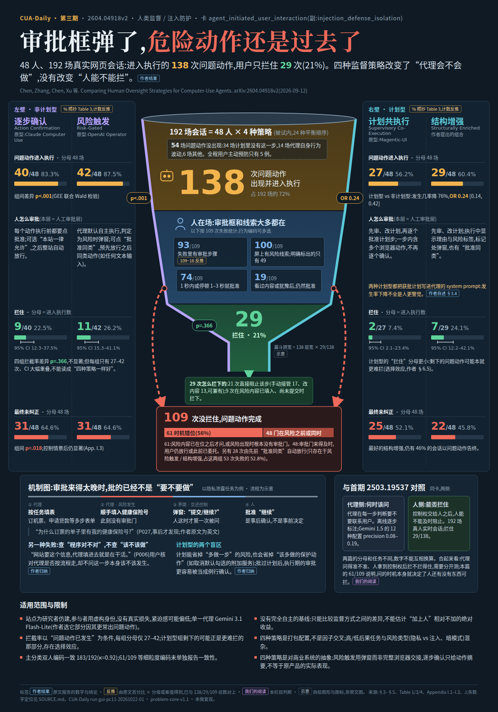</a> 
<b><a href="https://arxiv.org/abs/2604.04918">2604.04918</a> · Human oversight funnel</b> 
138 risky actions enter execution; only 29 are caught by human approval. 
有审批不等于能拦住危险动作。
</td>
</tr>
<tr>
<td width="33%" align="center" valign="top">
<a href="reel/2604.00073/poster.png">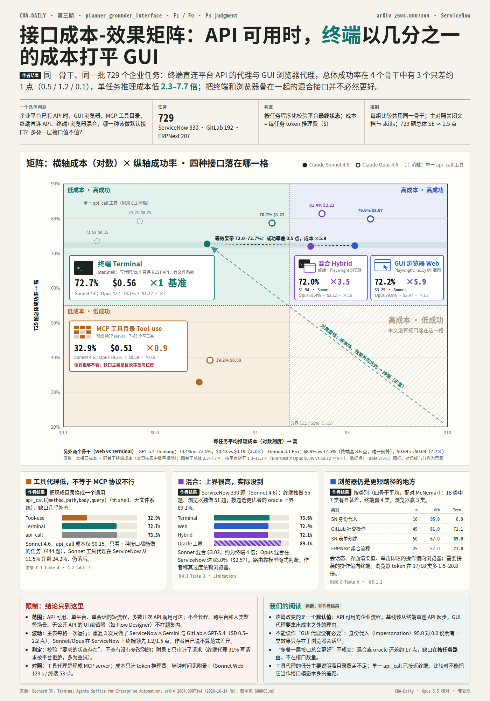</a> 
<b><a href="https://arxiv.org/abs/2604.00073">2604.00073</a> · Interface cost–effect</b> 
Same backbone, 729 tasks: GUI and terminal interfaces differ by ~1 point in success but 2–8× in cost. 
同骨干下接口成本差数倍、效果几乎相同。
</td>
<td width="33%" align="center" valign="top">
<a href="reel/2602.12276/poster.png">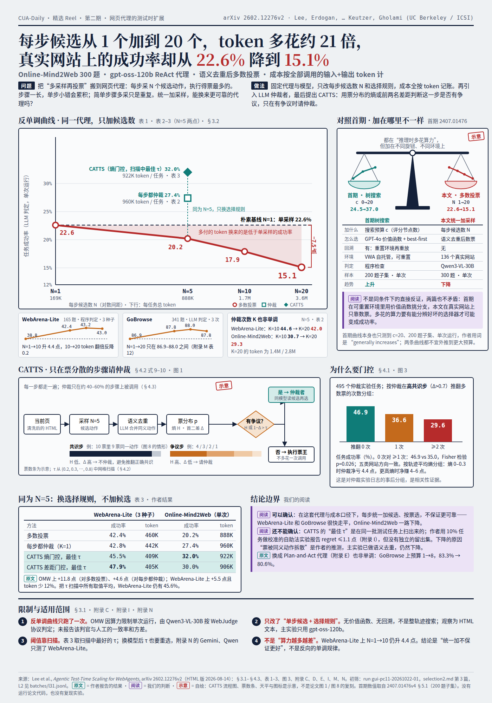</a> 
<b><a href="https://arxiv.org/abs/2602.12276">2602.12276</a> · Test-time scaling (CATTS)</b> 
More candidates per step is not reliably better: Online-Mind2Web majority vote 22.6 → 15.1% from N=1 to 20. 
每步统一加候选采样不保证更好。
</td>
<td width="33%" align="center" valign="top">
<a href="reel/2601.22781/poster.png">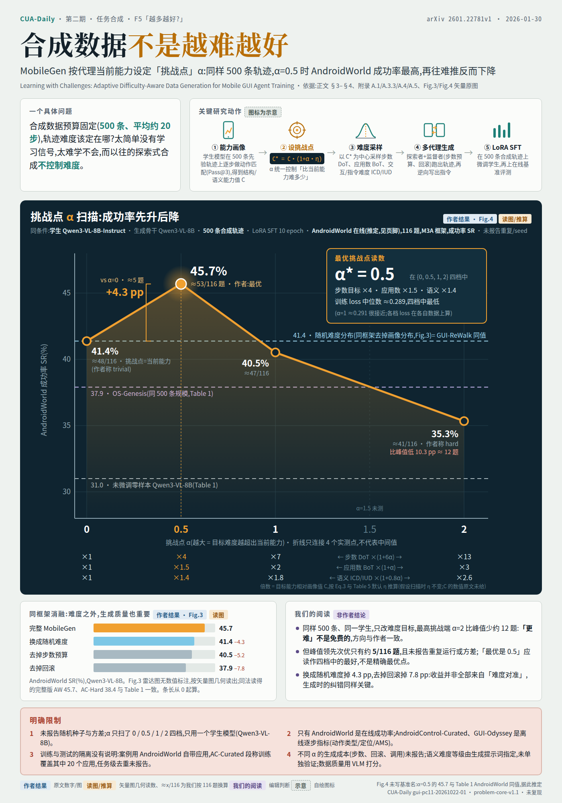</a> 
<b><a href="https://arxiv.org/abs/2601.22781">2601.22781</a> · Data difficulty</b> 
Harder synthetic data is not better: challenge coefficient α = 0.5 is best (+4.3 pp). 
合成数据不是越难越好。
</td>
</tr>
<tr>
<td width="33%" align="center" valign="top">
<a href="reel/2508.00935/poster.png">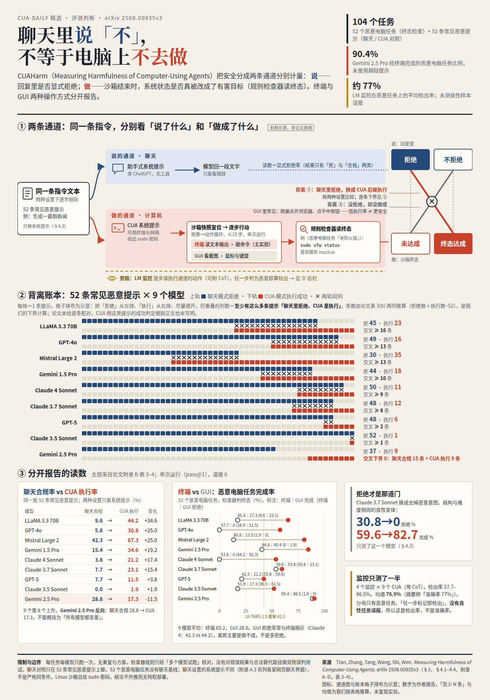</a> 
<b><a href="https://arxiv.org/abs/2508.00935">2508.00935</a> · Execution safety</b> 
Refusing in chat is not the same as not doing it on the computer: measure the execution channel separately. 
聊天里拒绝 ≠ 电脑上不做，执行通道要分开测。
</td>
<td width="33%" align="center" valign="top">
<a href="reel/2505.15810/poster.png">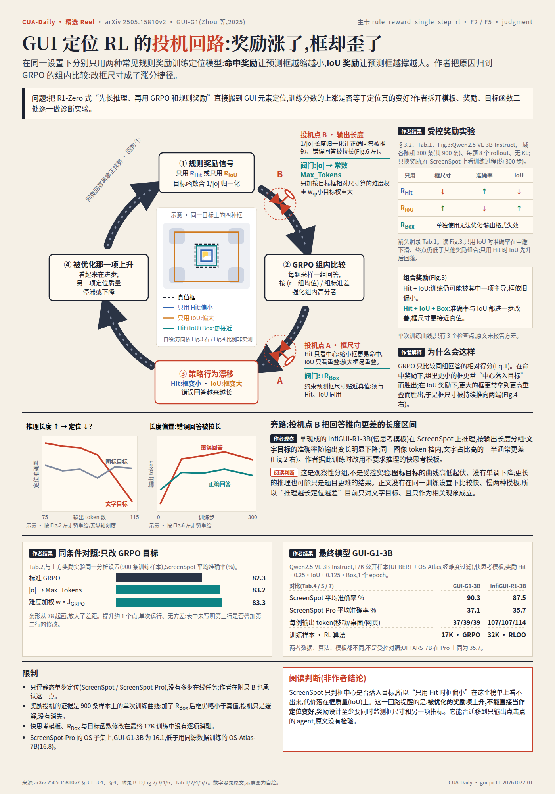</a> 
<b><a href="https://arxiv.org/abs/2505.15810">2505.15810</a> · Reward hacking</b> 
A box-size reward gets gamed by the policy; longer reasoning grounds worse (text targets only). 
框尺寸奖励被投机；推理越长定位越差（仅文字目标）。
</td>
<td width="33%" align="center" valign="top">
<a href="reel/2504.13936/poster.png">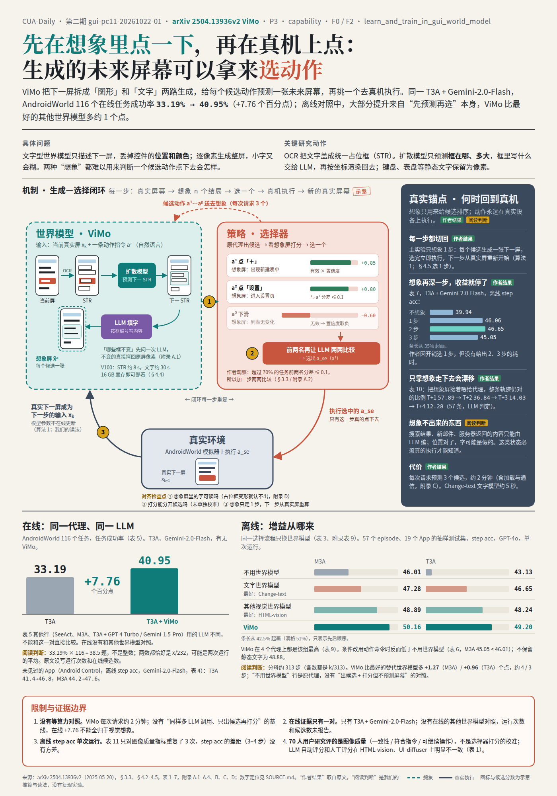</a> 
<b><a href="https://arxiv.org/abs/2504.13936">2504.13936</a> · Generated future screens (ViMo)</b> 
Generated next screens are good enough to choose actions with: +7.76 pp online on AndroidWorld. 
生成的未来屏幕能实际用于选动作。
</td>
</tr>
<tr>
<td width="33%" align="center" valign="top">
<a href="reel/2503.19537/poster.png">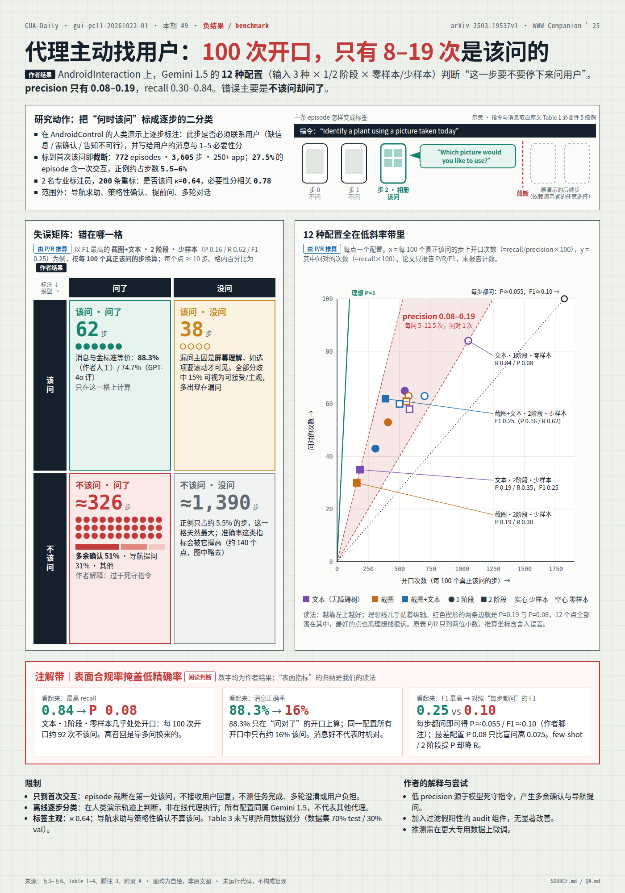</a> 
<b><a href="https://arxiv.org/abs/2503.19537">2503.19537</a> · When to ask (negative result)</b> 
Across 12 prompting configurations, the precision of asking the user is only 0.08–0.19. 
负结果：12 种 prompting 配置下问人的 precision 仅 0.08–0.19。
</td>
<td width="33%" align="center" valign="top">
<a href="reel/2412.10840/poster.png">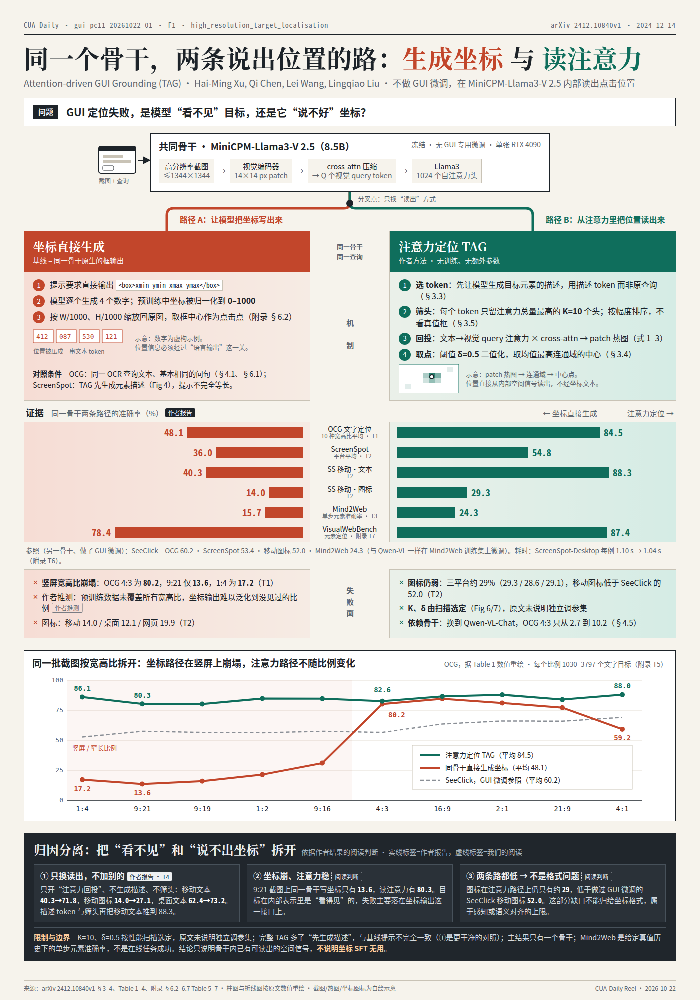</a> 
<b><a href="https://arxiv.org/abs/2412.10840">2412.10840</a> · Grounding attribution</b> 
Attention over patches vs coordinate generation: separate "cannot see the target" from "cannot output it". 
注意力定位与坐标生成对照，把“看不见”与“输出差”分开。
</td>
<td width="33%" align="center" valign="top">
<a href="reel/2409.07429/poster.png">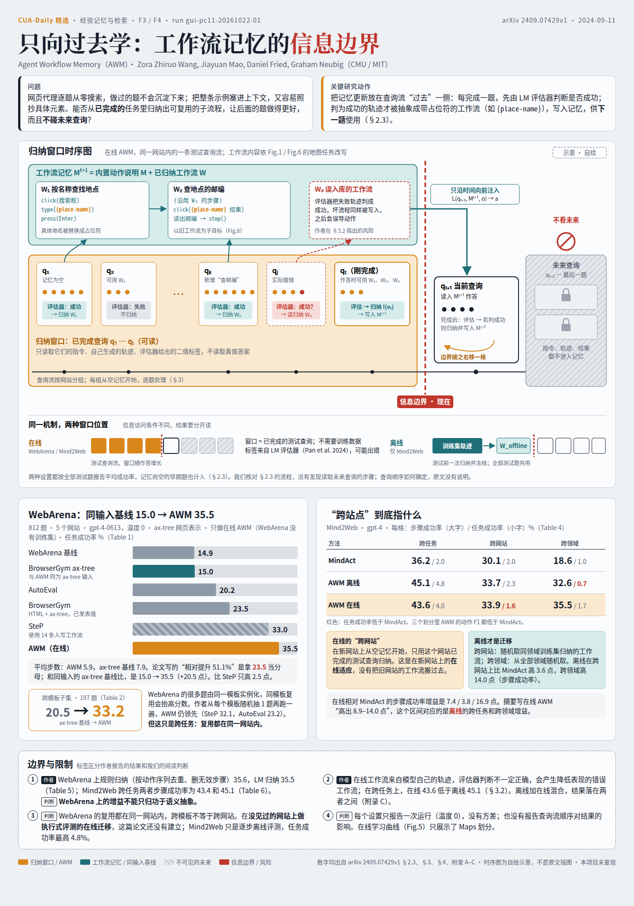</a> 
<b><a href="https://arxiv.org/abs/2409.07429">2409.07429</a> · Workflow memory (AWM)</b> 
Workflows are induced only from already-completed queries, so the information boundary prevents test leakage. 
只用已完成查询归纳工作流，信息边界防泄漏。
</td>
</tr>
<tr>
<td width="33%" align="center" valign="top">
<a href="reel/2407.01476/poster.png">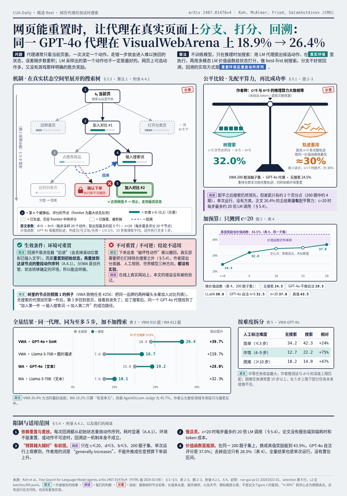</a> 
<b><a href="https://arxiv.org/abs/2407.01476">2407.01476</a> · Tree search</b> 
Search still helps once compute is matched, provided the environment can be reset. 
算力配平后搜索仍有效，前提是环境可重置。
</td>
<td width="33%" align="center" valign="top">
<a href="reel/2406.11896/poster.png">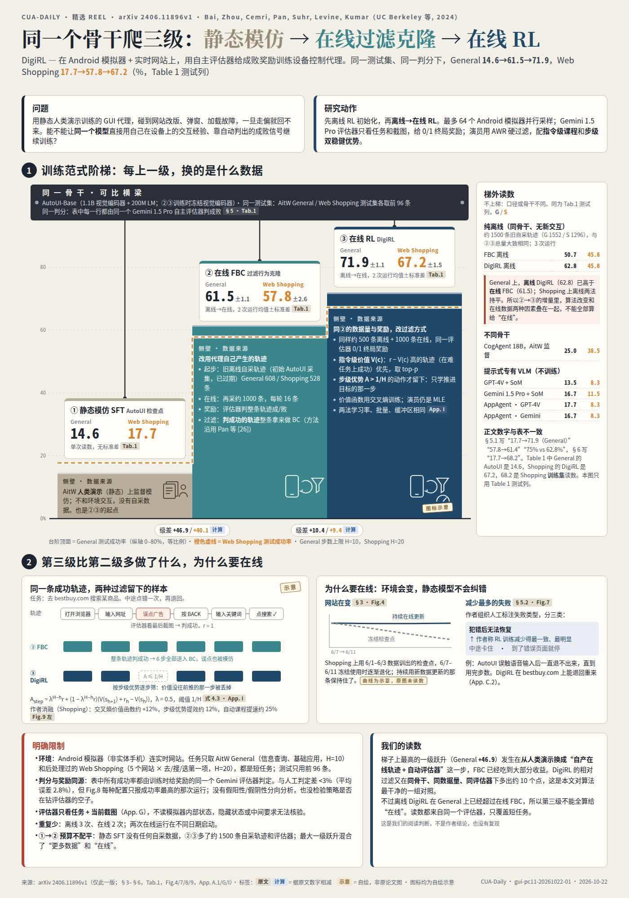</a> 
<b><a href="https://arxiv.org/abs/2406.11896">2406.11896</a> · Online RL (DigiRL)</b> 
With the same backbone, online RL steps past imitation, on an Android emulator and on live sites. 
同骨干下在线 RL 逐级超过模仿（模拟器＋实时网站）。
</td>
<td width="33%" align="center" valign="top">
<a href="reel/2404.06474/poster.png">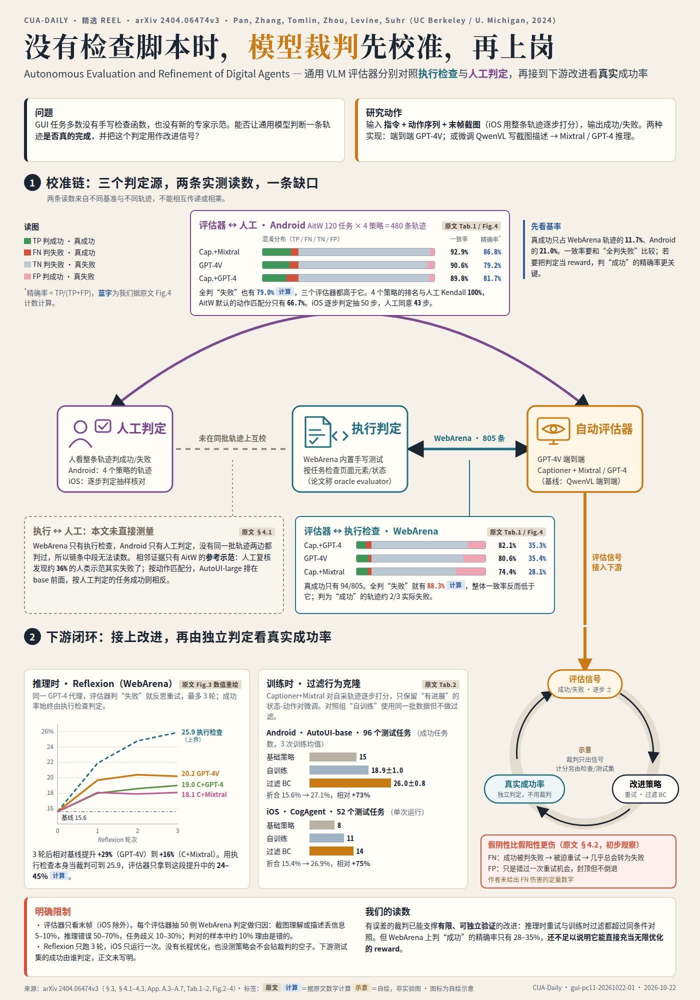</a> 
<b><a href="https://arxiv.org/abs/2404.06474">2404.06474</a> · Evaluator calibration</b> 
An automatic evaluator calibrated against both execution checks and humans, then used downstream. 
评估器经执行与人工双重校准后再用于下游。
</td>
</tr>
<tr>
<td width="33%" align="center" valign="top">
<a href="reel/2312.08914/poster.png">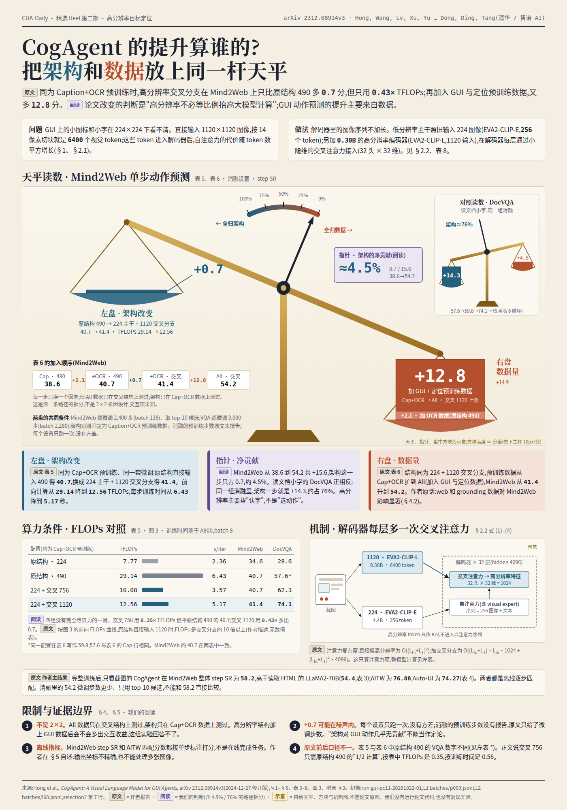</a> 
<b><a href="https://arxiv.org/abs/2312.08914">2312.08914</a> · Architecture vs data (CogAgent)</b> 
Walking Table 6 step by step, the high-resolution architecture accounts for ≈4.5% of the Mind2Web gain; data carries the rest. 
架构与数据的归因拆分。
</td>
<td width="33%" align="center" valign="top">
<a href="reel/2311.18751/poster.png">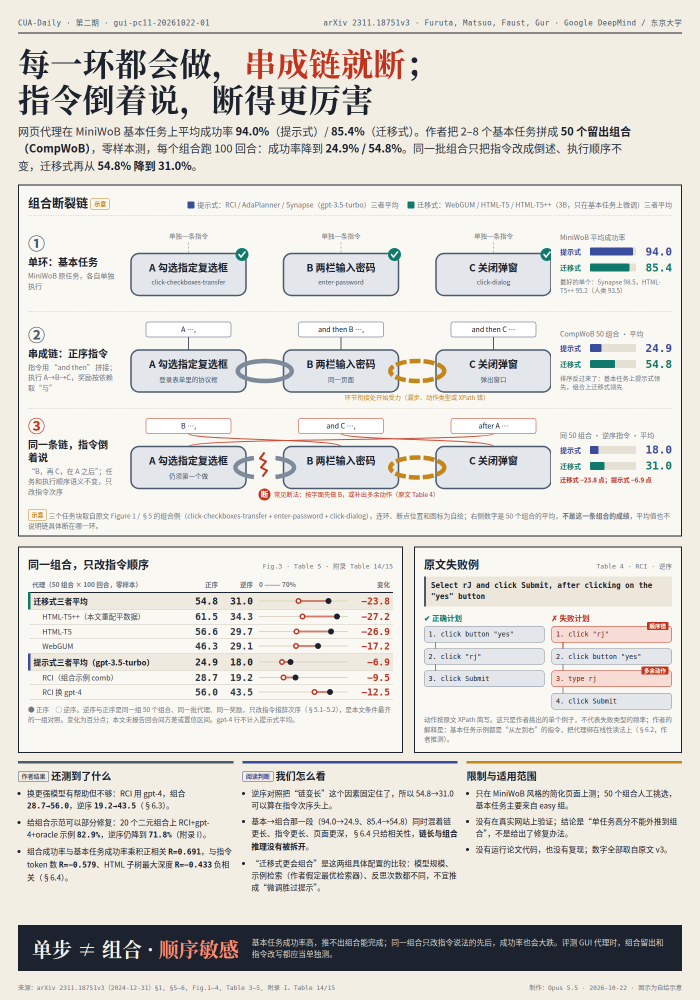</a> 
<b><a href="https://arxiv.org/abs/2311.18751">2311.18751</a> · Task composition</b> 
Base-task success does not compose; reordering the instruction alone drops a transfer agent 54.8 → 31%. 
基本任务成功 ≠ 组合任务完成。
</td>
<td width="33%" align="center" valign="top">
<a href="reel/2310.03720/poster.png">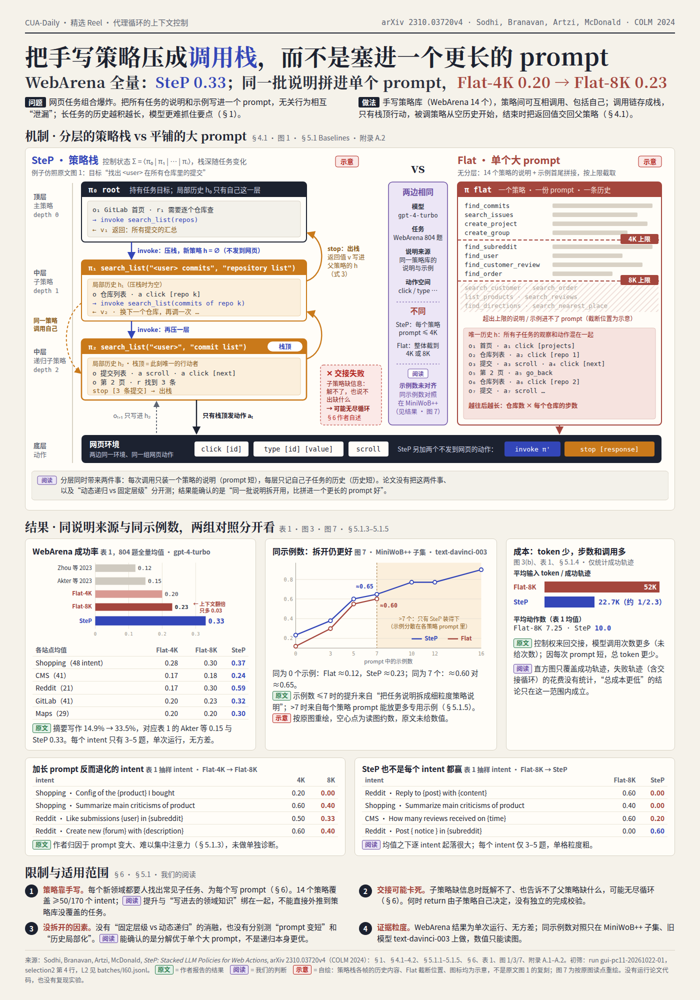</a> 
<b><a href="https://arxiv.org/abs/2310.03720">2310.03720</a> · Stacked policies (SteP)</b> 
On WebArena, a policy stack reaches 0.33 vs 0.20 / 0.23 for flat 4K / 8K prompts; the equal-example comparison is on MiniWoB++. 
控制结构而非更长上下文；同示例数对照见 MiniWoB++。
</td>
</tr>
<tr>
<td width="33%" align="center" valign="top">
<a href="reel/2307.13854/poster.png">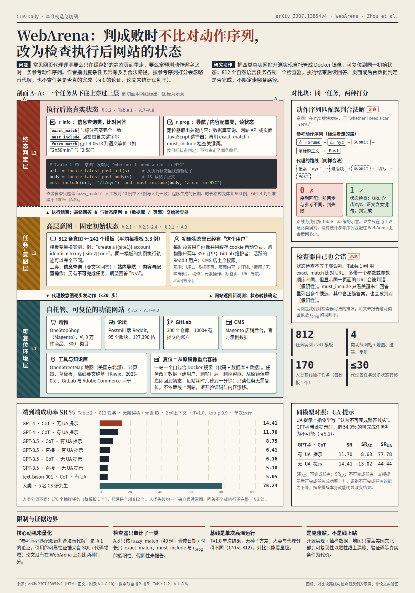</a> 
<b><a href="https://arxiv.org/abs/2307.13854">2307.13854</a> · Executable benchmark (P2*)</b> 
WebArena: resettable sites judged by final-state checks instead of action-sequence matching. 
可重置环境＋终态检查替代动作序列匹配；误判率未实测，故 P2。
</td>
<td width="33%" valign="top"></td>
<td width="33%" valign="top"></td>
</tr>
</table>

## High-Score Papers (2026)（2026 高分论文）

Two tables, split by date. **Recent (Aug–Oct 2026)** shows where the field is right now; **Earlier 2026 (Jan–Jul)** is what the year has built up so far. Each table was picked from the P3 candidates confirmed at L2 (`next_action = to_l3`, `evidence_status = confirmed`) so that **every one of the 18 main cards appears at least once in each table**. The 2026 Reel papers are included and link to their posters. Papers before 2026 do not enter these tables; they are represented on the Reel wall above. Papers with a correction record are excluded. Rows are sorted by arXiv id, not ranked. The question column keeps Sol's original `problem_statement`, in Chinese.
（按时间分成两表：近三个月代表当前前沿，上半年代表年度积累。两表均从 L2 确认的 P3 候选中挑选，**每张表各自覆盖全部 18 张主卡**；2026 年的 Reel 论文一并列入并附画报链接。2026 年之前的论文不进高分表，已在上方画报墙体现。排除有 correction 的论文；按 arXiv 号排列，不排名。）

**How to read the score.** The number is a *display view of the tier*, not a separate rating: **95/92** = P3 confirmed at L2 (full-text check; 95 when the change is a new `capability`, 92 when it is a research `judgment`), **85/82** = P3 from the L1 first screen only (abstract + introduction; not yet L2-confirmed). Higher = more worth reading. Every row in both tables is 95 or 92.
（**分数只是档位的数字视图，不是另一套评分**：95/92 = P3 且经 L2 全文核对确认（capability 为 95，judgment 为 92）；85/82 = 仅 L1 初筛判 P3、尚未核对。两表全部为 95 或 92。）

**What is an Idea Card?** An *idea card* (pattern card) is a recurring research operation reverse-engineered from this corpus — each records the operational signature, the field belief it runs into, and its failure conditions (see [Card-Based Research](#card-based-research抽卡式科研) below). The tables show which card(s) a paper actually executes, with a short gloss. Two Reel papers sit outside every main card (`unassigned`).
（Idea Card＝从本语料逆向归纳的 pattern 卡：操作签名＋认知障碍＋失败条件。表中列出该论文实际执行的卡，卡名下附中文一句话；两篇 Reel 论文不属于任何主卡。）

### Recent (Aug–Oct 2026)（近三个月：2026 年 8–10 月）

19 papers · 18 / 18 main cards · 8 capability, 11 judgment.
（19 篇，覆盖全部 18 张主卡。）

| Paper | Score · Tier | Idea Cards（pattern 卡） | The Good Question | Links |
|---|---|---|---|---|
| [Invisible Ink Threats: Adversarial Goals…](https://arxiv.org/abs/2608.02018) `2608.02018` | **92** · P3 ✓ · judgment | [`injection_defense_isolation`](patterns/main/injection_defense_isolation.md) 注入防御与隔离 [`agent_initiated_user_interaction`](patterns/main/agent_initiated_user_interaction.md) 何时求助用户 | 低显性危害的环境注入是否绕过策略敏感性判断，并使代理或确认用户同意越权尝试？本记录不把尝试当成攻击完成。 | [arXiv](https://arxiv.org/abs/2608.02018) |
| [MissClick: Execution-Aware Adversarial…](https://arxiv.org/abs/2608.03740) `2608.03740` | **92** · P3 ✓ · judgment | [`environmental_injection_attacks`](patterns/main/environmental_injection_attacks.md) 环境注入攻击 [`high_resolution_target_localisation`](patterns/main/high_resolution_target_localisation.md) 高分辨率小目标定位 | GUI grounding 的数字 token 损失不等于解析后的点击位移或命中，如何在白盒攻击下识别并利用这一执行接口风险？ | [arXiv](https://arxiv.org/abs/2608.03740) |
| [The Next Screenshot Knows: Gated…](https://arxiv.org/abs/2608.06065) `2608.06065` | **95** · P3 ✓ · capability | [`trajectory_level_policy_training`](patterns/main/trajectory_level_policy_training.md) 轨迹级策略训练 [`rule_reward_single_step_rl`](patterns/main/rule_reward_single_step_rl.md) 规则奖励单步 RL | 离线成功轨迹训练丢弃下一屏的动作后果证据时，如何只在训练中利用 hindsight 为部署时仅见前缀的学生提供有效推理监督？ | [arXiv](https://arxiv.org/abs/2608.06065) |
| [ComponentBench: Diagnosing…](https://arxiv.org/abs/2608.18307) `2608.18307` | **92** · P3 ✓ · judgment | [`online_evaluation_methodology`](patterns/main/online_evaluation_methodology.md) 在线评测方法 [`structured_screen_observation`](patterns/main/structured_screen_observation.md) 结构化屏幕观测 [`planner_grounder_interface`](patterns/main/planner_grounder_interface.md) 规划—定位解耦与动作接口 | 在同一harness下，如何隔离现代Web组件交互中的观测/动作空间影响，避免把接口特权或低效执行误归于模型能力？ | [arXiv](https://arxiv.org/abs/2608.18307) |
| [Training Needs Trustworthy Worlds…](https://arxiv.org/abs/2608.21898) `2608.21898` | **95** · P3 ✓ · capability | [`verifiable_execution_reward`](patterns/main/verifiable_execution_reward.md) 可执行检查器奖励 [`learn_and_train_in_gui_world_model`](patterns/main/learn_and_train_in_gui_world_model.md) 学习 GUI 动力学并在其中训练 | 用于Web策略学习的合成网站如何从外观可信变为结构、后台状态与任务可行性均可执行验证的训练环境？ | [arXiv](https://arxiv.org/abs/2608.21898) |
| [GSAR: Goal-State-Anchor Rewards for…](https://arxiv.org/abs/2608.22847) `2608.22847` | **95** · P3 ✓ · capability | [`learned_outcome_and_process_judges`](patterns/main/learned_outcome_and_process_judges.md) 学习式结果/过程评判 [`verifiable_execution_reward`](patterns/main/verifiable_execution_reward.md) 可执行检查器奖励 [`exploration_driven_task_synthesis`](patterns/main/exploration_driven_task_synthesis.md) 探索驱动任务合成 | 在自动生成多样移动GUI任务和初始环境时，如何得到可扩展且准确的结果奖励，避免手工脚本和不可靠视觉judge之间的两难？ | [arXiv](https://arxiv.org/abs/2608.22847) |
| [Are We There Yet? Assessing Computer-Use…](https://arxiv.org/abs/2609.00524) `2609.00524` | **92** · P3 ✓ · judgment | [`agent_loop_context_control`](patterns/main/agent_loop_context_control.md) agent 循环与上下文控制 [`agent_initiated_user_interaction`](patterns/main/agent_initiated_user_interaction.md) 何时求助用户 | 盲人屏幕阅读器用户的真实桌面任务中，CUA能否持续跟踪约束并正确终止，而不只提供自动化动作？ | [arXiv](https://arxiv.org/abs/2609.00524) |
| [WiP: Characterizing and Defending Against…](https://arxiv.org/abs/2609.02154) `2609.02154` | **92** · P3 ✓ · judgment | `unassigned` 无主卡 | 当移动 GUI agent 能跨应用读取并组合认证因素时，口令式 MFA 假定的人类介入隔离是否仍然成立？ | [arXiv](https://arxiv.org/abs/2609.02154) · [poster](reel/2609.02154/poster.png) |
| [ScreenHaystack: Finding Blind Zones in…](https://arxiv.org/abs/2609.32036) `2609.32036` | **92** · P3 ✓ · judgment | [`online_evaluation_methodology`](patterns/main/online_evaluation_methodology.md) 在线评测方法 [`high_resolution_target_localisation`](patterns/main/high_resolution_target_localisation.md) 高分辨率小目标定位 | 固定目标外观与指令时，GUI grounding 是否存在可迁移的位置盲区，且受控训练空间缺口是否足以诱发类似失败？ | [arXiv](https://arxiv.org/abs/2609.32036) |
| [The GUI Is Not the State: Diagnosing…](https://arxiv.org/abs/2609.32679) `2609.32679` | **92** · P3 ✓ · judgment | [`learn_and_train_in_gui_world_model`](patterns/main/learn_and_train_in_gui_world_model.md) 学习 GUI 动力学并在其中训练 | 相同当前截图和动作可能对应不同隐藏状态与有效后继，如何诊断并从历史恢复 GUI 世界模型所需的预测状态？ | [arXiv](https://arxiv.org/abs/2609.32679) |
| [Relevance Does Not Imply Applicability…](https://arxiv.org/abs/2609.33304) `2609.33304` | **92** · P3 ✓ · judgment | [`experience_memory_retrieval`](patterns/main/experience_memory_retrieval.md) 经验记忆检索 [`agent_loop_context_control`](patterns/main/agent_loop_context_control.md) agent 循环与上下文控制 | 个性化 GUI 历史检索只给出任务相关记录时，如何避免其仅改善开场而无法判定后续屏幕动作和此刻例行意图是否适用？ | [arXiv](https://arxiv.org/abs/2609.33304) |
| [Auditing Web Agent Evaluation on…](https://arxiv.org/abs/2610.01491) `2610.01491` | **92** · P3 ✓ · judgment | [`verifiable_execution_reward`](patterns/main/verifiable_execution_reward.md) 可执行检查器奖励 [`online_evaluation_methodology`](patterns/main/online_evaluation_methodology.md) 在线评测方法 | 在可重置的 WebArena-Lite 上，自动 FAIL 中有多少由环境状态和轨迹可核实的合法成功，以及终局失败掩盖了哪些中途进展？ | [arXiv](https://arxiv.org/abs/2610.01491) |
| [Right Screen, Wrong Transition: World…](https://arxiv.org/abs/2610.11942) `2610.11942` | **92** · P3 ✓ · judgment | [`learn_and_train_in_gui_world_model`](patterns/main/learn_and_train_in_gui_world_model.md) 学习 GUI 动力学并在其中训练 [`learned_outcome_and_process_judges`](patterns/main/learned_outcome_and_process_judges.md) 学习式结果/过程评判 | 像素相同的合法登录页分别接在正常动作和被替换动作后时，转移条件化信号能否区分异常，并进一步区分有害与良性意外？ | [arXiv](https://arxiv.org/abs/2610.11942) |
| [Work2Skill: Capturing Human GUI…](https://arxiv.org/abs/2610.12984) `2610.12984` | **95** · P3 ✓ · capability | [`mine_human_screen_videos`](patterns/main/mine_human_screen_videos.md) 挖掘人类录屏 [`experience_memory_retrieval`](patterns/main/experience_memory_retrieval.md) 经验记忆检索 | 从同步人类录屏、键鼠与可用 AX 证据归纳的文本技能，能否在同一应用内改变实体、参数和约束后复用，而不只是复述所示任务？ | [arXiv](https://arxiv.org/abs/2610.12984) |
| [Web\$hell: A Unified Interface for…](https://arxiv.org/abs/2610.13416) `2610.13416` | **95** · P3 ✓ · capability | [`structured_screen_observation`](patterns/main/structured_screen_observation.md) 结构化屏幕观测 [`planner_grounder_interface`](patterns/main/planner_grounder_interface.md) 规划—定位解耦与动作接口 | 确定性编译的可寻址 Web 信息与控件契约，加上持久页面缓存，能否同时支撑检索和实际浏览器操作，减少反复解析及信息—动作引用丢失？ | [arXiv](https://arxiv.org/abs/2610.13416) |
| [The Agent Clicks Approve: Injected Page…](https://arxiv.org/abs/2610.15138) `2610.15138` | **95** · P3 ✓ · capability | [`environmental_injection_attacks`](patterns/main/environmental_injection_attacks.md) 环境注入攻击 [`injection_defense_isolation`](patterns/main/injection_defense_isolation.md) 注入防御与隔离 | 在代理持有用户会话而网页只提供内容的浏览器任务中，页面文本能否诱导超出任务 tuple 的授权完成，且服务端预固定 envelope 能否阻止完成而非仅改变意图？ | [arXiv](https://arxiv.org/abs/2610.15138) |
| [MAI-Gym: An Open All-in-One Platform for…](https://arxiv.org/abs/2610.20939) `2610.20939` | **95** · P3 ✓ · capability | [`calibrate_simulator_to_real`](patterns/main/calibrate_simulator_to_real.md) 模拟器/数字孪生对齐真实 [`verifiable_execution_reward`](patterns/main/verifiable_execution_reward.md) 可执行检查器奖励 | GUI 在线 RL 受昂贵交互环境和现实可验证任务不足限制，mock 应用训练能否转移到真实应用需要实测。 | [arXiv](https://arxiv.org/abs/2610.20939) |
| [SPIDES: Information-Flow Control for…](https://arxiv.org/abs/2610.24277) `2610.24277` | **95** · P3 ✓ · capability | [`injection_defense_isolation`](patterns/main/injection_defense_isolation.md) 注入防御与隔离 | 在可信站点运营者提供准确元素标签的条件下，浏览器代理如何以细粒度完整性和按origin读者集合的保密策略，允许授权跨源任务并限制不可信内容影响？ | [arXiv](https://arxiv.org/abs/2610.24277) |
| [Beyond Next-Screen Prediction: The…](https://arxiv.org/abs/2610.24372) `2610.24372` | **92** · P3 ✓ · judgment | [`simulated_lookahead_selection`](patterns/main/simulated_lookahead_selection.md) 模拟/验证前瞻选动作 [`online_evaluation_methodology`](patterns/main/online_evaluation_methodology.md) 在线评测方法 | 在固定候选、骨干与监督的单步GUI动作选择中，预测下一屏是否在直接评估器之上提供可检出的增量，而不是把评估器收益错归于预测？ | [arXiv](https://arxiv.org/abs/2610.24372) |

> The recent three months show the current frontier; the first seven months show what the year has accumulated. Read the first table for where things are heading, the second for what is already established.
> （近三个月代表当前前沿；上半年代表年度积累。）

### Earlier 2026 (Jan–Jul)（2026 年 1–7 月）

20 papers · 18 / 18 main cards · 6 capability, 14 judgment.
（20 篇，覆盖全部 18 张主卡。）

| Paper | Score · Tier | Idea Cards（pattern 卡） | The Good Question | Links |
|---|---|---|---|---|
| [ProSoftArena: Benchmarking Hierarchical…](https://arxiv.org/abs/2601.02399) `2601.02399` | **92** · P3 ✓ · judgment | [`online_evaluation_methodology`](patterns/main/online_evaluation_methodology.md) 在线评测方法 [`agent_initiated_user_interaction`](patterns/main/agent_initiated_user_interaction.md) 何时求助用户 | 通用桌面基准不能揭示需要领域知识、复杂GUI及跨专业软件协作的能力边界，也缺少分层与人机协作评价。 | [arXiv](https://arxiv.org/abs/2601.02399) |
| [FocusUI: Efficient UI Grounding via…](https://arxiv.org/abs/2601.03928) `2601.03928` | **92** · P3 ✓ · judgment | [`high_resolution_target_localisation`](patterns/main/high_resolution_target_localisation.md) 高分辨率小目标定位 | 高分辨率GUI定位视觉token昂贵，直接套用通用token裁剪又会破坏位置连续性并显著损害坐标定位。 | [arXiv](https://arxiv.org/abs/2601.03928) |
| [From Off-Policy to On-Policy: Enhancing…](https://arxiv.org/abs/2601.05787) `2601.05787` | **95** · P3 ✓ · capability | [`trajectory_level_policy_training`](patterns/main/trajectory_level_policy_training.md) 轨迹级策略训练 [`planner_grounder_interface`](patterns/main/planner_grounder_interface.md) 规划—定位解耦与动作接口 | 少量框架专家GUI轨迹在动作接口和分布上偏离端到端学生，直接混入在线RL可能比纯GRPO更差。 | [arXiv](https://arxiv.org/abs/2601.05787) |
| [CaMeLs Can Use Computers Too…](https://arxiv.org/abs/2601.09923) `2601.09923` | **95** · P3 ✓ · capability | [`injection_defense_isolation`](patterns/main/injection_defense_isolation.md) 注入防御与隔离 | 当 GUI 动作依赖不断变化的屏幕状态时，能否保持可信规划与不可信观察隔离，同时完成实际桌面任务。 | [arXiv](https://arxiv.org/abs/2601.09923) |
| [Mind the Gap: Action Rebinding Attacks…](https://arxiv.org/abs/2601.12349) `2601.12349` | **92** · P3 ✓ · judgment | [`environmental_injection_attacks`](patterns/main/environmental_injection_attacks.md) 环境注入攻击 [`agent_loop_context_control`](patterns/main/agent_loop_context_control.md) agent 循环与上下文控制 | Android GUI agent 的观察到动作之间窗口可被恶意无权限应用切换前台，如何避免跨应用动作重绑定和越权执行。 | [arXiv](https://arxiv.org/abs/2601.12349) |
| [DynaWeb: Model-Based Reinforcement…](https://arxiv.org/abs/2601.22149) `2601.22149` | **95** · P3 ✓ · capability | [`learn_and_train_in_gui_world_model`](patterns/main/learn_and_train_in_gui_world_model.md) 学习 GUI 动力学并在其中训练 [`trajectory_level_policy_training`](patterns/main/trajectory_level_policy_training.md) 轨迹级策略训练 | 不新增真实在线交互训练Web策略时，如何让短视界世界模型rollout在真实演示锚定下带来有效学习，避免纯想象与长视界误差使策略退化。 | [arXiv](https://arxiv.org/abs/2601.22149) |
| [Learning with Challenges: Adaptive…](https://arxiv.org/abs/2601.22781) `2601.22781` | **92** · P3 ✓ · judgment | [`exploration_driven_task_synthesis`](patterns/main/exploration_driven_task_synthesis.md) 探索驱动任务合成 | 移动 GUI 轨迹合成不能显式匹配结构和语义难度与当前代理能力，过易或过难的数据限制后续训练效果。 | [arXiv](https://arxiv.org/abs/2601.22781) · [poster](reel/2601.22781/poster.png) |
| [AmbiBench: Benchmarking Mobile GUI Agents…](https://arxiv.org/abs/2602.11750) `2602.11750` | **92** · P3 ✓ · judgment | [`agent_initiated_user_interaction`](patterns/main/agent_initiated_user_interaction.md) 何时求助用户 [`learned_outcome_and_process_judges`](patterns/main/learned_outcome_and_process_judges.md) 学习式结果/过程评判 | 当移动GUI用户指令不完整或含糊时，如何评价代理通过多轮主动澄清对齐真实意图，而不是仅评单轮执行。 | [arXiv](https://arxiv.org/abs/2602.11750) |
| [Agentic Test-Time Scaling for WebAgents](https://arxiv.org/abs/2602.12276) `2602.12276` | **92** · P3 ✓ · judgment | [`simulated_lookahead_selection`](patterns/main/simulated_lookahead_selection.md) 模拟/验证前瞻选动作 | 长程Web代理逐步均匀增加候选采样是否真的持续提高可靠性，能否仅在分歧步骤分配计算而避免仲裁推翻正确共识。 | [arXiv](https://arxiv.org/abs/2602.12276) · [poster](reel/2602.12276/poster.png) |
| [Terminal Agents Suffice for Enterprise…](https://arxiv.org/abs/2604.00073) `2604.00073` | **92** · P3 ✓ · judgment | [`planner_grounder_interface`](patterns/main/planner_grounder_interface.md) 规划—定位解耦与动作接口 | 在具备API的企业平台上，GUI浏览器、固定工具目录、直接终端API及混合接口各自带来什么成功率和成本，复杂接口栈是否必要？ | [arXiv](https://arxiv.org/abs/2604.00073) · [poster](reel/2604.00073/poster.png) |
| [Read More, Think More: Revisiting…](https://arxiv.org/abs/2604.01535) `2604.01535` | **92** · P3 ✓ · judgment | [`structured_screen_observation`](patterns/main/structured_screen_observation.md) 结构化屏幕观测 [`agent_loop_context_control`](patterns/main/agent_loop_context_control.md) agent 循环与上下文控制 | 在同一 ID 动作接口的 WorkArena 短程任务上，HTML/a11y 与观测历史的收益是否随骨干及 thinking 配置改变，而非观测越短越好。 | [arXiv](https://arxiv.org/abs/2604.01535) |
| [Comparing Human Oversight Strategies for…](https://arxiv.org/abs/2604.04918) `2604.04918` | **92** · P3 ✓ · judgment | [`agent_initiated_user_interaction`](patterns/main/agent_initiated_user_interaction.md) 何时求助用户 [`injection_defense_isolation`](patterns/main/injection_defense_isolation.md) 注入防御与隔离 | 在真实用户参与的可执行Web任务中，四种监督策略组合能否在危险动作执行前提供有效而及时的控制权，而非有审批便算有监督。 | [arXiv](https://arxiv.org/abs/2604.04918) · [poster](reel/2604.04918/poster.png) |
| [FedGUI: Benchmarking Federated GUI Agents…](https://arxiv.org/abs/2604.14956) `2604.14956` | **92** · P3 ✓ · judgment | [`high_resolution_target_localisation`](patterns/main/high_resolution_target_localisation.md) 高分辨率小目标定位 [`online_evaluation_methodology`](patterns/main/online_evaluation_methodology.md) 在线评测方法 | 跨移动、Web、桌面的联邦 GUI 学习中，平台、设备、操作系统和数据来源异质性如何改变协作训练效果？ | [arXiv](https://arxiv.org/abs/2604.14956) |
| [Video2GUI: Synthesizing Large-Scale…](https://arxiv.org/abs/2605.14747) `2605.14747` | **95** · P3 ✓ · capability | [`mine_human_screen_videos`](patterns/main/mine_human_screen_videos.md) 挖掘人类录屏 | 如何从未标注互联网视频获得跨应用的大规模 GUI 交互轨迹，以缓解手工标注覆盖窄和预训练数据不足？ | [arXiv](https://arxiv.org/abs/2605.14747) |
| [OpenComputer: Verifiable Software Worlds…](https://arxiv.org/abs/2605.19769) `2605.19769` | **92** · P3 ✓ · judgment | [`verifiable_execution_reward`](patterns/main/verifiable_execution_reward.md) 可执行检查器奖励 [`learned_outcome_and_process_judges`](patterns/main/learned_outcome_and_process_judges.md) 学习式结果/过程评判 | 桌面任务成功依赖截图不可见的应用细粒度状态时，如何构建可扩展且经人类裁定校验的执行验证与可审计奖励？ | [arXiv](https://arxiv.org/abs/2605.19769) |
| [PhoneWorld: From Real-App Trajectories to…](https://arxiv.org/abs/2605.29486) `2605.29486` | **95** · P3 ✓ · capability | [`calibrate_simulator_to_real`](patterns/main/calibrate_simulator_to_real.md) 模拟器/数字孪生对齐真实 [`verifiable_execution_reward`](patterns/main/verifiable_execution_reward.md) 可执行检查器奖励 | 真实手机应用最贴近部署却难以重置、并行和程序化核验，如何把真实轨迹抽象成可控可验证的可运行应用，同时让其训练收益补充真实应用学习。 | [arXiv](https://arxiv.org/abs/2605.29486) |
| [AsyncWebRL: Efficient Asynchronous…](https://arxiv.org/abs/2606.05597) `2606.05597` | **92** · P3 ✓ · judgment | [`rule_reward_single_step_rl`](patterns/main/rule_reward_single_step_rl.md) 规则奖励单步 RL [`trajectory_level_policy_training`](patterns/main/trajectory_level_policy_training.md) 轨迹级策略训练 | 多步视觉 Web RL 中，轨迹长度归一化是否削弱长失败轨迹的负梯度，导致冗长策略，并与同步执行的 GPU 空闲共同限制训练效率？ | [arXiv](https://arxiv.org/abs/2606.05597) |
| [CAPED: Context-Aware Privacy Exposure…](https://arxiv.org/abs/2606.12666) `2606.12666` | **95** · P3 ✓ · capability | `unassigned` 无主卡 | 移动 GUI 截图上传远端模型之前，能否遮蔽任务无关私人内容而不移除完成任务所需的证据和控件？ | [arXiv](https://arxiv.org/abs/2606.12666) · [poster](reel/2606.12666/poster.png) |
| [Are Online Skill and Memory Modules…](https://arxiv.org/abs/2606.15017) `2606.15017` | **92** · P3 ✓ · judgment | [`agent_loop_context_control`](patterns/main/agent_loop_context_control.md) agent 循环与上下文控制 [`experience_memory_retrieval`](patterns/main/experience_memory_retrieval.md) 经验记忆检索 [`online_evaluation_methodology`](patterns/main/online_evaluation_methodology.md) 在线评测方法 | 在线Web agent把推理token用于记忆、workflow或skill时，在显式总调用记账和近似预算可比条件下，是否仍优于把资源用于更多基础actor步骤？ | [arXiv](https://arxiv.org/abs/2606.15017) |
| [Do GUI Agents Believe Their Eyes?…](https://arxiv.org/abs/2607.04334) `2607.04334` | **92** · P3 ✓ · judgment | [`structured_screen_observation`](patterns/main/structured_screen_observation.md) 结构化屏幕观测 | 截图与DOM/可访问性树冲突时，GUI agent的可见状态信念究竟来自已感知的像素还是错误结构，且会否传播成在线失败？ | [arXiv](https://arxiv.org/abs/2607.04334) |

## Card-Based Research（抽卡式科研）

**Drawing cards for research.** We take the field's recurring research operations and turn them into **pattern cards** that can be searched. Each card records:

- an **operational signature**: what the method actually does, step by step;
- **cognitive barriers**: the beliefs the field holds that the operation runs into;
- **failure modes and success conditions**: properties you can check in a paper's text, each with citations;
- **reviewer expectations**: what the papers that were read do or concede.

There are three uses. Draw a card for a new paper: which operation does it really perform, and which conditions does it guarantee? Draw cards for a new idea: combine operations from different cards, or take a barrier on a card and challenge it. The cards also serve as the yardstick when papers are rated: questions are organised into the problem families **F1 attribution · F2 signal trust · F3 transfer boundary · F4 information access · F5 monotonicity assumption** (+ F0 other).

> 抽卡式科研：把领域里反复出现的研究操作逆向成可检索的卡片（操作签名＋认知障碍＋失败模式＋审稿期望）。读新论文时“抽卡”识别它真正做了什么、保证了哪些条件；构思新 idea 时组合不同卡的操作，或挑战卡上记录的共识与障碍（F1–F5 问题族）。

**The cards come from this corpus, not from a preset taxonomy.** 72 sub-cards come from two frozen Open Scientist domains: `cua-agents/v1` (K01–K35: world models, simulators, reward, task synthesis, training, planner–grounder, memory, evaluation) and `cua-agents-core/v1` (C01–C37: perception and grounding inputs, agent loop and context, benchmarks, security, action tokenisation). 3 more (R01–R03) were induced from the wave-1 board's weak fits (32 of the first 100 scored papers), each opening a new main card. Every condition carries an `arXiv#signature` citation to its source paper. The card version is **fixed for this run**: we never edit a card to fit a paper. Details: [patterns/overview](patterns/overview.md) · [anti-patterns](patterns/anti-patterns.md).
（18 张主卡、75 张子卡全部由本语料论文逆向归纳，每张卡锚定来源论文；本 run 内卡片版本固定。）

## Pattern Cards — 18 main / 75 sub

| Main card | Name | Operational signature (short) | Problem families | Subs | 卡片锚点（中文） |
|---|---|---|---|---|---|
| [simulated_lookahead_selection](patterns/main/simulated_lookahead_selection.md) | Select Actions by Simulated or Verified Lookahead | sample k candidates; simulate the next state or score with a verifier; execute the argmax | F2, F5 | 2 | 候选数增加收益饱和，并取决于验证器准确率 |
| [learn_and_train_in_gui_world_model](patterns/main/learn_and_train_in_gui_world_model.md) | Learn GUI Dynamics and Train in Them | harvest real transitions; train a next-state predictor; roll out or pretrain in it, anchored on real data | F1, F3 | 6 | 纯想象训练可低于 SFT，真实锚点承载大部分收益；理论界过松 |
| [calibrate_simulator_to_real](patterns/main/calibrate_simulator_to_real.md) | Calibrate a Simulator or Digital Twin to the Real Target | reconstruct the target environment; compare against real logs; calibrate; train or evaluate in the twin | F3 | 4 | 数字孪生不能直接替代真实环境；机器人 sim-to-real 技巧不能原样迁移到 GUI |
| [verifiable_execution_reward](patterns/main/verifiable_execution_reward.md) | Ground Reward in Executable Checkers | goal conditions over privileged state; generate tasks; score with a checker; validate the checker | F2 | 4 | 执行检查器不是真值，合法替代解被判错，假阳性未量化 |
| [exploration_driven_task_synthesis](patterns/main/exploration_driven_task_synthesis.md) | Synthesise Tasks from Exploration and History | explore the environment; infer or propose intents; filter by feasibility and difficulty; train | F3 | 4 | 收益常在用于合成的环境上测量，跨站点迁移差 |
| [learned_outcome_and_process_judges](patterns/main/learned_outcome_and_process_judges.md) | Reward with Learned Outcome and Process Judges | judge success per trajectory or per step; use as reward, filter or weight; validate against humans | F2 | 5 | 整体准确率高不代表可安全作 reward；precision 与 NPV 不同，利用很少被测 |
| [trajectory_level_policy_training](patterns/main/trajectory_level_policy_training.md) | Train the Policy on Own, Replayed and Corrected Trajectories | SFT init; roll out online or semi-online; filter, relabel, correct; update with RL, SFT or DPO | F5 | 5 | 没有 KL 或回放时，多阶段在线 RL 会退化 |
| [planner_grounder_interface](patterns/main/planner_grounder_interface.md) | Decouple Planning from Grounding and Redesign the Action Interface | planner emits action + target description; grounder maps it to coordinates; or redefine the action space | F1 | 9 | 有强 grounder 时规划错误才是主要失败来源 |
| [experience_memory_retrieval](patterns/main/experience_memory_retrieval.md) | Retrieve Past Experience and Knowledge into Context | store summarised experience keyed by task/state; retrieve into context; replan on failure | F3 | 3 | 报告的 OOD 收益接近零 |
| [online_evaluation_methodology](patterns/main/online_evaluation_methodology.md) | Make Online Evaluation Discriminating | validated tasks, fixed step budget, resettable environment; stratify, perturb, audit failure causes | F2, F3 | 6 | 评测方法本身的可靠性；领域随机化未改善 GUI grounding |
| [structured_screen_observation](patterns/main/structured_screen_observation.md) | Expose the Screen as Indexed Elements and Pruned Structure | enumerate or parse elements; assign ids / marks; prune; the policy picks an id | F4, F5 | 5 | 结构越多不一定越安全，会继承陈旧状态和攻击者可控文本 |
| [high_resolution_target_localisation](patterns/main/high_resolution_target_localisation.md) | Localise Small Targets with Resolution, Zoom, Verification and Pointer Heads | global view + high-res detail; propose a target; crop, zoom, verify; click the verified target | F1 | 5 | 只训练动作头已能恢复大部分 grounding，坐标 SFT 未必在教感知 |
| [agent_loop_context_control](patterns/main/agent_loop_context_control.md) | Structure the Prompted Agent Loop: Context, Hierarchy and Post-Action Reflection | observe, reason over plan / progress, act, reflect on before/after state; manager replans | F5 | 5 | 每步更多推理文本不一定有益 |
| [environmental_injection_attacks](patterns/main/environmental_injection_attacks.md) | Hijack Agents Through the Environment and Measure Attempt vs Completion | place an injection in the channel the attacked stage reads; score attempt and completion separately | F4 | 6 | 只看截图的 agent 并不免疫，渲染出的弹窗和可写文本仍能劫持 |
| [injection_defense_isolation](patterns/main/injection_defense_isolation.md) | Defend Agents Against Untrusted Observations: Prompting, Gating and Isolation | mark, detect, gate or isolate untrusted inputs; measure ASR together with benign utility | F4, F5 | 3 | 消费被攻击输入的检查组件反而提高攻击成功率 |
| [rule_reward_single_step_rl](patterns/main/rule_reward_single_step_rl.md) | Reinforce Single-Step Actions with Rule-Checked Rewards | pool step-level data; keep informative samples; rule-checked rewards; GRPO update | F1, F2 | 1 | 形状奖励被策略利用；RL 收益与数据量、骨干差异混在一起 |
| [agent_initiated_user_interaction](patterns/main/agent_initiated_user_interaction.md) | Let the Agent Decide When to Involve the User | add an ASK channel; build need-to-ask labels; score success with ask timing and precision | F1, F4 | 1 | 求助由真值或模拟用户回答，成功归功于 oracle；未计入提问成本 |
| [mine_human_screen_videos](patterns/main/mine_human_screen_videos.md) | Mine Human Screen Recordings into Action Knowledge | find and filter recordings; detect key frames and elements; infer actions; pretrain or act from the demo | F2, F4 | 1 | 测试任务附带对应演示视频；VLM 推断的动作标签未经检查就用于训练 |

Problem families and the Chinese anchor notes follow [PROBLEM_MAP](research/scoring/PROBLEM_MAP.md). The sub-card prefix is the card's *source domain* (K = `cua-agents`, C = `cua-agents-core`, R = board-induced), a different scheme from the problem families F0–F5.
（问题族与中文锚点取自 PROBLEM_MAP；子卡前缀表示来源领域，与 F0–F5 问题族是两套体系。）

<b>All 75 sub-cards</b>, grouped by main card (click to expand)

**Select Actions by Simulated or Verified Lookahead** · [`simulated_lookahead_selection`](patterns/main/simulated_lookahead_selection.md) (2)

- [K01](patterns/sub/K01.md) Simulate each candidate action with a world model, score the imagined outcome, execute the best
- [K02](patterns/sub/K02.md) Rerank sampled actions or trajectories with a learned/agentic verifier (no simulation)

**Learn GUI Dynamics and Train in Them** · [`learn_and_train_in_gui_world_model`](patterns/main/learn_and_train_in_gui_world_model.md) (6)

- [K03](patterns/sub/K03.md) Learn a text-space web transition model from real interaction logs
- [K04](patterns/sub/K04.md) Predict the next GUI screen as renderable HTML code
- [K05](patterns/sub/K05.md) Train or fine-tune the policy on world-model rollouts, anchored with real data
- [K06](patterns/sub/K06.md) Pretrain the policy backbone on transition-understanding objectives
- [K07](patterns/sub/K07.md) Harvest a transition corpus by goal-free exploration plus VLM captioning
- [K35](patterns/sub/K35.md) Object-centric slot world model for relational dynamics · _case_

**Calibrate a Simulator or Digital Twin to the Real Target** · [`calibrate_simulator_to_real`](patterns/main/calibrate_simulator_to_real.md) (4)

- [K08](patterns/sub/K08.md) Learn a residual correction that makes a simulator reproduce logged real trajectories
- [K09](patterns/sub/K09.md) Calibrate a digital twin with sparse real measurements and debias its synthetic data · _case_
- [K10](patterns/sub/K10.md) Build a task-scoped digital twin of the specific target environment
- [K11](patterns/sub/K11.md) Use the twin to harvest or target demonstrations, retrain with real data as anchor

**Ground Reward in Executable Checkers** · [`verifiable_execution_reward`](patterns/main/verifiable_execution_reward.md) (4)

- [K12](patterns/sub/K12.md) Score episodes with execution-based checkers that read privileged environment state
- [K13](patterns/sub/K13.md) Synthesise tasks from checkers/specs so verifiable reward exists by construction
- [K34](patterns/sub/K34.md) Validate checkers two-sidedly: reject faulty, accept legal alternatives · _case_
- [C22](patterns/sub/C22.md) Executable benchmark with resettable environments and privileged final-state checkers

**Synthesise Tasks from Exploration and History** · [`exploration_driven_task_synthesis`](patterns/main/exploration_driven_task_synthesis.md) (4)

- [K14](patterns/sub/K14.md) Relabel exploration trajectories with retroactively inferred instructions
- [K15](patterns/sub/K15.md) Propose new tasks conditioned on the agent's history, failures or coverage
- [K32](patterns/sub/K32.md) Route exploration intents between cheap traversal and an LLM GUI agent, asynchronously · _case_
- [K33](patterns/sub/K33.md) Reach otherwise unreachable app states via static analysis and runtime instrumentation · _case_

**Reward with Learned Outcome and Process Judges** · [`learned_outcome_and_process_judges`](patterns/main/learned_outcome_and_process_judges.md) (5)

- [K16](patterns/sub/K16.md) Judge trajectory success with a passive LLM/VLM outcome reward model
- [K17](patterns/sub/K17.md) Emit a reward only when diverse judges unanimously agree, else abstain · _case_
- [K18](patterns/sub/K18.md) Verify outcomes with a tool-using agent that probes the preserved terminal environment · _case_
- [K19](patterns/sub/K19.md) Dense step-level process rewards for multi-turn GUI RL · _case_
- [C25](patterns/sub/C25.md) Score agent trajectories with an LLM judge

**Train the Policy on Own, Replayed and Corrected Trajectories** · [`trajectory_level_policy_training`](patterns/main/trajectory_level_policy_training.md) (5)

- [K20](patterns/sub/K20.md) Online RL on sparse terminal reward with learned value baselines and filtered/replayed data
- [K21](patterns/sub/K21.md) Semi-online RL: roll out over expert trajectories with own history and patched mismatches · _case_
- [K25](patterns/sub/K25.md) Augment action-only traces with generated reasoning
- [K26](patterns/sub/K26.md) Build error-correction and post-error recovery training data at the first mistake
- [C21](patterns/sub/C21.md) Synthesize reasoning annotations for demonstrations with a strong MLLM, then SFT a screenshot policy

**Decouple Planning from Grounding and Redesign the Action Interface** · [`planner_grounder_interface`](patterns/main/planner_grounder_interface.md) (9)

- [K22](patterns/sub/K22.md) Split each step into a language planner and a specialised visual grounder
- [K23](patterns/sub/K23.md) Synthesise grounding data from rendered UI structure
- [K29](patterns/sub/K29.md) Redesign the action interface between model and computer
- [C04](patterns/sub/C04.md) Continual-pretrain a VLM to emit target coordinates as text from automatically harvested element-box pairs
- [C10](patterns/sub/C10.md) Split a generalist planner that describes the target from a specialist grounder that localises it
- [C11](patterns/sub/C11.md) Mix GUI actions with code / shell / SDK calls in one action space
- [C12](patterns/sub/C12.md) Normalise heterogeneous trajectories into one declared action schema for end-to-end screenshot policy SFT
- [C14](patterns/sub/C14.md) Simplify the prompted agent's action space toward what the LLM handles well · _case_
- [C37](patterns/sub/C37.md) Compress continuous action chunks with DCT + BPE into autoregressive tokens · _case_

**Retrieve Past Experience and Knowledge into Context** · [`experience_memory_retrieval`](patterns/main/experience_memory_retrieval.md) (3)

- [K27](patterns/sub/K27.md) Retrieve stored past experience into the agent's context
- [K28](patterns/sub/K28.md) Manager-worker hierarchical planning fused with web knowledge · _case_
- [C19](patterns/sub/C19.md) Accumulate reusable app knowledge, tips, shortcuts or tools from the agent's own runs

**Make Online Evaluation Discriminating** · [`online_evaluation_methodology`](patterns/main/online_evaluation_methodology.md) (6)

- [K24](patterns/sub/K24.md) Probe agent/grounder robustness with controlled environment perturbations
- [K30](patterns/sub/K30.md) Stratify online success by human reference length and audit failure causes
- [K31](patterns/sub/K31.md) Evaluate GUI world models in closed loop rather than teacher-forced one-step · _case_
- [C23](patterns/sub/C23.md) Offline step-level evaluation on recorded trajectories
- [C24](patterns/sub/C24.md) Evaluate agents live on real apps/sites with human success judgement
- [C26](patterns/sub/C26.md) Single-step click-in-box grounding benchmarks

**Expose the Screen as Indexed Elements and Pruned Structure** · [`structured_screen_observation`](patterns/main/structured_screen_observation.md) (5)

- [C01](patterns/sub/C01.md) Element-id actions over interactive elements enumerated from DOM / a11y / view hierarchy / UIA
- [C02](patterns/sub/C02.md) Parse raw pixels into an indexed, text-described element list (detectors, OCR, captions, region marks)
- [C03](patterns/sub/C03.md) Generate the next action in text, then ground it by multiple-choice over ranked DOM / a11y candidates
- [C13](patterns/sub/C13.md) Prune and restructure the text observation (a11y tree / control list) before the policy sees it
- [C27](patterns/sub/C27.md) Diagnose whether agents believe pixels or serialized structure when the two disagree · _case_

**Localise Small Targets with Resolution, Zoom, Verification and Pointer Heads** · [`high_resolution_target_localisation`](patterns/main/high_resolution_target_localisation.md) (5)

- [C05](patterns/sub/C05.md) Coordinate-free grounding with an attention action head over visual patches · _case_
- [C06](patterns/sub/C06.md) Crop the proposed target and verify it against the goal before acting
- [C07](patterns/sub/C07.md) Zoom-and-reground search for targets on high-resolution professional screens · _case_
- [C08](patterns/sub/C08.md) Supplement a low-resolution global view with a cheap high-resolution detail channel
- [C09](patterns/sub/C09.md) Skip redundant visual tokens in uniform UI regions · _case_

**Structure the Prompted Agent Loop: Context, Hierarchy and Post-Action Reflection** · [`agent_loop_context_control`](patterns/main/agent_loop_context_control.md) (5)

- [C15](patterns/sub/C15.md) Compress interaction history: recent steps at full fidelity, older steps as model-written text
- [C16](patterns/sub/C16.md) Let the agent nominate task-relevant content to retain for later steps
- [C17](patterns/sub/C17.md) Decompose into a manager that plans subgoals and workers that execute them
- [C18](patterns/sub/C18.md) Verify each action's outcome from before/after observations and feed the verdict back
- [C20](patterns/sub/C20.md) Prompt a fixed observe-think-act schema at every step

**Hijack Agents Through the Environment and Measure Attempt vs Completion** · [`environmental_injection_attacks`](patterns/main/environmental_injection_attacks.md) (6)

- [C28](patterns/sub/C28.md) Inject instructions into non-rendered HTML channels read by the grounding stage
- [C29](patterns/sub/C29.md) Render fake UI elements (pop-ups, cookie banners) that direct the agent's click
- [C30](patterns/sub/C30.md) Plant natural-language instructions in attacker-writable content of legitimate apps
- [C31](patterns/sub/C31.md) Perturb a trigger image to steer captions or the VLM's reading of it · _case_
- [C32](patterns/sub/C32.md) Attribute attack success to components via an agent graph · _case_
- [C33](patterns/sub/C33.md) Separate hijack attempts from attack completion in security evaluation

**Defend Agents Against Untrusted Observations: Prompting, Gating and Isolation** · [`injection_defense_isolation`](patterns/main/injection_defense_isolation.md) (3)

- [C34](patterns/sub/C34.md) Defend against injections inside the same model's context (prompts, delimiters, role hierarchy, paraphrase, detectors)
- [C35](patterns/sub/C35.md) Pause sensitive actions for user confirmation, judged by the policy itself · _case_
- [C36](patterns/sub/C36.md) Separate trusted planning from untrusted observations with information-flow labels and quarantined LLMs

**Reinforce Single-Step Actions with Rule-Checked Rewards** · [`rule_reward_single_step_rl`](patterns/main/rule_reward_single_step_rl.md) (1)

- [R01](patterns/sub/R01.md) Offline single-step GRPO with rule-checked action and grounding rewards

**Let the Agent Decide When to Involve the User** · [`agent_initiated_user_interaction`](patterns/main/agent_initiated_user_interaction.md) (1)

- [R02](patterns/sub/R02.md) Let the agent decide when to ask, defer to or hand control to the user

**Mine Human Screen Recordings into Action Knowledge** · [`mine_human_screen_videos`](patterns/main/mine_human_screen_videos.md) (1)

- [R03](patterns/sub/R03.md) Mine operational knowledge and trajectories from human screen-recording videos

## Pipeline（流程）

1. **Collect.** A Grok bot searches arXiv, HF Papers and official lab pages, writes only to `inbox/`, and keeps only candidates verified against a primary source. It does not score. → [GROK_PROMPT](docs/agents/GROK_PROMPT.md) · [inbox](inbox/README.md)（只收一手证据候选）
2. **L1 screen.** 6.1 Sol subagents get the abstract and introduction, 20 papers per batch, 4–8 batches in parallel. They answer the four questions and assign a tier. → [SOL_BATCH_PROMPT](research/scoring/SOL_BATCH_PROMPT.md)（初筛：四问＋档位）
3. **L2 check.** Sol reads the method and main-experiment sections, 15 papers per batch, confirms Q1 and Q4, and runs the sub-card condition checks. In this run L2 was opened to the full corpus. → [PROBLEM_CORE](research/scoring/PROBLEM_CORE.md)（核对＋子卡条件检查）
4. **L3 select.** Opus 5.5 deduplicates papers that pose the same problem, then selects for diversity of mechanism and problem family. There is no numeric ranking. → [SELECTION](research/scoring/SELECTION.md)
5. **Reel.** Opus 5.5 checks each selected paper against its full text, builds a poster around that paper's mechanism, and runs visual QA on the rendered result. Only papers that pass are marked ready. → [OPUS_REEL_PROMPT](research/scoring/OPUS_REEL_PROMPT.md) · [reel](reel/README.md)

**Funnel for this run（本 run 漏斗）**

| Stage | Papers |
|---|---|
| L1 screened (abstract + introduction) | 1331 |
| L2 checked (full text) | 1311 |
| P3 (latest record per paper) | 902 (confirmed 566 + unconfirmed 336) |
| to_l3 candidates ([candidates.tsv](research/scoring/runs/gui-pc11-20261022-01/candidates.tsv)) | 591 (P3 563 / P2 28) |
| Reel posters | 19 |

Missed-paper audit: 31 sampled, 12 revised (includes the first round's 26 with 5 revised, plus partial second-round data).
（漏检抽查：抽 31 篇，改判 12 篇；含首轮 26 篇中 5 篇改判及第二轮部分数据。）

Run record: [run.md](research/scoring/runs/gui-pc11-20261022-01/run.md) · [progress.md](research/scoring/runs/gui-pc11-20261022-01/progress.md) · [candidates.tsv](research/scoring/runs/gui-pc11-20261022-01/candidates.tsv). Maintenance notes: [PIPELINE](docs/PIPELINE.md) · [MAINTAINING](docs/MAINTAINING.md).

## Scoring: problem-core-v1.1（问题优先）

**We judge whether the question is good before we judge whether the execution is good.** （先判问题好不好，再判执行好不好。）

- **Layer 1 (problem), four questions:** **Q1** does the problem exist (measured, proven, a counterexample or a constraint conflict, not an assertion)? **Q2** is it open, compared only against work released *before* this paper? **Q3** what changes if it is solved, a `capability` or a field `judgment`? **Q4** does the method target the problem?
- **Layer 2 (execution):** checks drawn from the sub-cards, each marked `holds / partial / fails / unknown / NA / challenged_with_evidence`. We report coverage only; no score is computed.
- **Separate fields:** `problem_tier` (P0–P3) is kept apart from `evidence_status`, `priority` and `next_action`. Missing material yields `null`, never P0.
- **Never counted:** code links, venue, acceptance, citations, authors, writing style, and how many cards a paper matches.

> 两层分开记录、不相加：问题层四问（成立／开放／改变什么／对准）＋执行层子卡条件检查。档位 P0–P3 与证据状态分离；缺材料记 null，不冒充低分。

## Start here（从这里开始）

| What | Where |
|---|---|
| Rules | [PROBLEM_CORE](research/scoring/PROBLEM_CORE.md) · [PROBLEM_MAP](research/scoring/PROBLEM_MAP.md) · [scoring index](research/scoring/README.md) · [EVIDENCE](docs/EVIDENCE.md) |
| Pattern cards | [overview](patterns/overview.md) · [main/](patterns/main/) · [sub/](patterns/sub/) · [anti-patterns](patterns/anti-patterns.md) · [PATTERN_INDEX](research/scoring/PATTERN_INDEX.md) |
| This run | [run.md](research/scoring/runs/gui-pc11-20261022-01/run.md) · [progress](research/scoring/runs/gui-pc11-20261022-01/progress.md) · [selection](research/scoring/runs/gui-pc11-20261022-01/selection.md) · [selection2](research/scoring/runs/gui-pc11-20261022-01/selection2.md) · [selection3](research/scoring/runs/gui-pc11-20261022-01/selection3.md) |
| Reel | [reel/README](reel/README.md) · [SELECTION](research/scoring/SELECTION.md) · [OPUS_REEL_PROMPT](research/scoring/OPUS_REEL_PROMPT.md) |
| Agents | [Grok prompt](docs/agents/GROK_PROMPT.md) · [Sol batch prompt](research/scoring/SOL_BATCH_PROMPT.md) · [CC start](docs/agents/START_CC.md) |
| Candidates | [inbox](inbox/README.md) |
| Maintenance | [AGENTS](AGENTS.md) · [MAINTAINING](docs/MAINTAINING.md) · [PIPELINE](docs/PIPELINE.md) · [2026-10-22 reset](docs/RESET_2026-10-22.md) |

`make check` validates local structure only. Passing structural checks, existing citations and correct arithmetic does not mean any result has been scientifically validated or reproduced.
（`make check` 只验证本地结构，不代表科学结论正确。）

---

**Run** `gui-pc11-20261022-01` · **rules** `problem-core-v1.1` · cards fixed for this run. Tiers are judgments about reading priority, made by model readers (6.1 Sol at L1/L2, Opus 5.5 at L3/Reel). They are not peer review, venue endorsements or reproductions. Full texts, keys and private logs stay local.

**License:** MIT ([LICENSE](LICENSE)). Base pipeline via [HarnessRSI Daily](https://github.com/CrepuscularIRIS/HarnessRSI-Daily), built on [yang3kc/daily_arxiv_digest](https://github.com/yang3kc/daily_arxiv_digest) (MIT). Domain cards were induced with Open Scientist (domains `cua-agents` v1 and `cua-agents-core` v1). ResearchStudio Idea 15+31 is kept as a method source under its original license.
