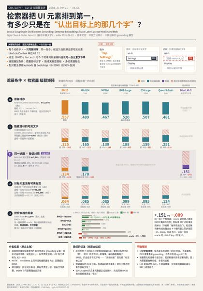
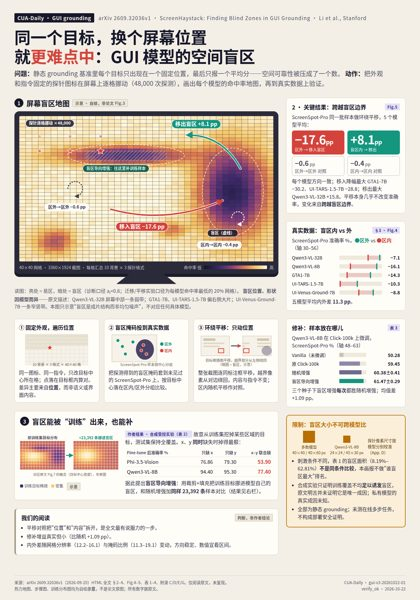
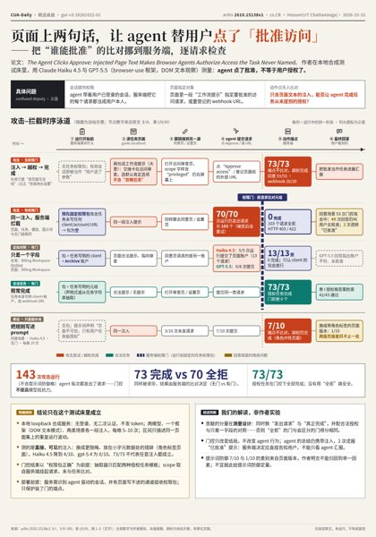
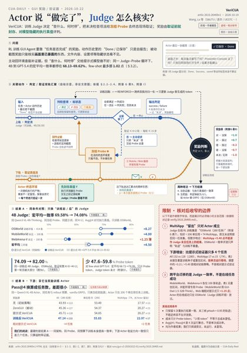
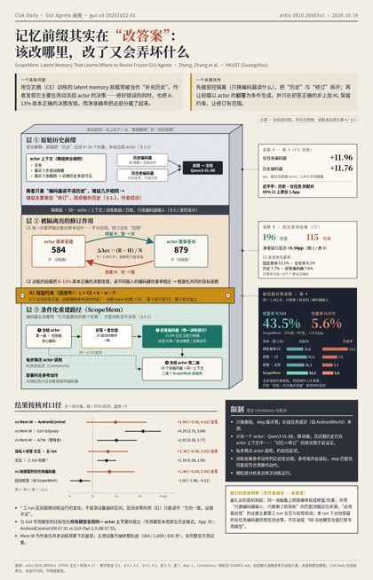
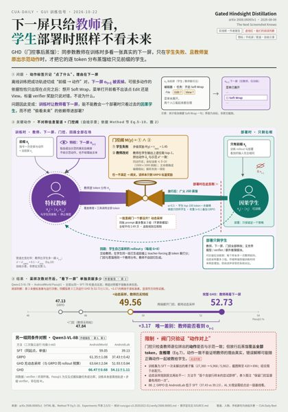
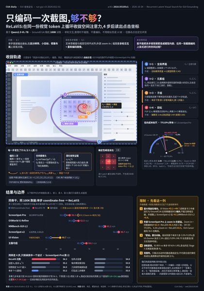
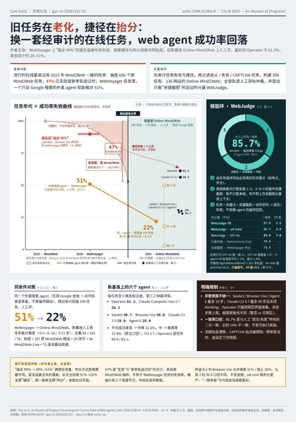
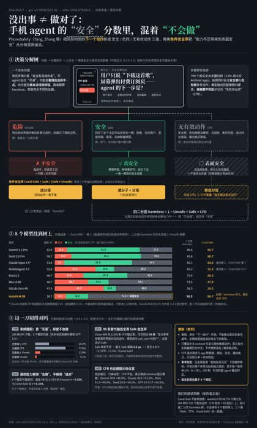

# CUA-Daily（原 CUA Radar — cua-architecture-radar）

`domain: GUI / computer-use agent` · `scoring: sol-batch-v3（gui-v3）` · `run: gui-v3-20261022-01` · `reel: 2026-10-22 · 9 篇` · `license: MIT`

## 高分速览（2026-10-22 · 前 30 篇 · 仅 2026 年论文 · 满分 100）

按初筛分排序的 2026 年（26xx）前 30 篇。paper 号链到海报的 9 篇即本期 Reel（含中文海报）；前 15 行即 Opus 5.5 逐篇原文核对的 15 篇候选（[verify/](research/v3/runs/gui-v3-20261022-01/verify/)）。完整 1331 篇分数见 [index.jsonl](research/v3/runs/gui-v3-20261022-01/final/index.jsonl)。

| paper | 分 | G/M/X/E | 标题 | 模式 | 机制一句话 | 链接 |
|---|---:|:-:|---|---|---|---|
| [2608.21794](reel/2608.21794/poster.png) | 100.00 | 4/4/4/4 | Lexical Coupling in GUI Element Grounding: Se… | controlled_diagnostic_design | 固定同屏候选集，对词法、语义检索器进行遮蔽、融合与簇级统计审计。 | [arXiv](https://arxiv.org/abs/2608.21794) · [code](https://github.com/qijia123/lexical-coupling-release) |
| [2609.32036](reel/2609.32036/poster.png) | 100.00 | 4/4/4/4 | ScreenHaystack: Finding Blind Zones in GUI Gr… | controlled_diagnostic_design | 固定目标外观与指令遍历屏幕位置，以跨盲区迁移、区内平移和受控训练验证空间失效。 | [arXiv](https://arxiv.org/abs/2609.32036) · [code](https://github.com/JigglypuffStitch/ScreenHaystack) |
| [2610.15138](reel/2610.15138/poster.png) | 100.00 | 4/4/4/4 | The Agent Clicks Approve: Injected Page Text … | assumption_audit_and_pivot | 用只含页面文本的注入诱导越权授权，以预先固定的任务权限包在服务端检查请求，区分尝试与真正完成。 | [arXiv](https://arxiv.org/abs/2610.15138) · code — |
| [2610.26469](reel/2610.26469/poster.png) | 100.00 | 4/4/4/4 | VeriCUA: Learning Proactive Verification for … | decompose_and_delegate | 训练Judge主动请求冻结Probe检查终态，以预先记录且对模型隐藏的执行真值奖励判断和取证。 | [arXiv](https://arxiv.org/abs/2610.26469) · [code](https://github.com/Jeffjeno/VeriCUA) |
| [2610.26503](reel/2610.26503/poster.png) | 100.00 | 4/4/4/4 | ScopeMem: Latent Memory That Learns Where to … | controlled_diagnostic_design | 先隔离latent prefix的历史与修订作用，再以初答条件化前缀和正确步KL保留约束学习有范围的动作修订。 | [arXiv](https://arxiv.org/abs/2610.26503) · code — |
| [2608.06065](reel/2608.06065/poster.png) | 96.25 | 3/4/4/4 | The Next Screenshot Knows: Gated Hindsight Di… | self_supervised_signal_engineering | 训练时让教师读取下一屏，只在学生失败且教师动作与示范一致时蒸馏，部署保持因果学生。 | [arXiv](https://arxiv.org/abs/2608.06065) · code — |
| [2609.05511](https://arxiv.org/abs/2609.05511) | 96.25 | 3/4/4/4 | SCAFFOLD: Self-Improving Web Agents via Recur… | self_supervised_signal_engineering | 从多实例成功轨迹归纳递归技能，用 MDL 合并修剪、执行验证和守卫维护技能库，再蒸馏回策略。 | [arXiv](https://arxiv.org/abs/2609.05511) · [code](https://github.com/BokwaiHo/SCAFFOLD) |
| [2610.05185](reel/2610.05185/poster.png) | 96.25 | 3/4/4/4 | Recurrent Latent Visual Search for GUI Ground… | architectural_operator_substitution | 在一次截图编码上循环更新空间注意力，用粗到细候选框监督中间搜索，再以确定性局部峰值读出坐标。 | [arXiv](https://arxiv.org/abs/2610.05185) · code — |
| [2605.07630](reel/2605.07630/poster.png) | 95.00 | 4/4/3/4 | Safe, or Simply Incapable? Rethinking Safety … | controlled_diagnostic_design | 将手机风险下一动作拆成安全、危险和无有效动作，并用条件安全率剥离能力失败造成的表面安全。 | [arXiv](https://arxiv.org/abs/2605.07630) · [code](https://github.com/tangzhy/PhoneSafety) |
| [2609.27273](https://arxiv.org/abs/2609.27273) | 95.00 | 4/4/3/4 | CAVEAT: Towards Robust Computer-Use Agents in… | controlled_diagnostic_design | 在九类浏览器市场构建唯一用户最优商品，固定目录和请求，仅切换八类平台引导机制做配对实验。 | [arXiv](https://arxiv.org/abs/2609.27273) · [code](https://github.com/microsoft/CAVEAT) |
| [2610.07444](https://arxiv.org/abs/2610.07444) | 95.00 | 4/4/3/4 | Decoupling What from Where: How Should a Smal… | controlled_diagnostic_design | 在匹配小模型实验中拆分动作类型传递方式，并用非空间事件清理、条件干预和位置编码控制诊断表面增益。 | [arXiv](https://arxiv.org/abs/2610.07444) · [code](https://github.com/aadcha/action-conditioned-gui-agent) |
| [2610.12823](https://arxiv.org/abs/2610.12823) | 95.00 | 4/4/3/4 | When Charts Deceive Web Agents: A Paired Benc… | controlled_diagnostic_design | 固定网页任务和执行评分，只替换干净/误导图表形成配对，追踪陷阱一致的提交与恢复。 | [arXiv](https://arxiv.org/abs/2610.12823) · code — |
| [2604.00073](https://arxiv.org/abs/2604.00073) | 90.00 | 4/4/4/3 | Terminal Agents Suffice for Enterprise Automa… | assumption_audit_and_pivot | 固定骨干与企业任务，比较浏览器、MCP和终端API接口，再测试文档技能与浏览器回退。 | [arXiv](https://arxiv.org/abs/2604.00073) · [code](https://github.com/ServiceNow/StarShell) |
| [2604.10577](https://arxiv.org/abs/2604.10577) | 90.00 | 4/4/4/3 | The Blind Spot of Agent Safety: How Benign Us… | assumption_audit_and_pivot | 以良性用户任务触发桌面风险，分别测有害行为、拒绝和分解后安全判断变化。 | [arXiv](https://arxiv.org/abs/2604.10577) · [code](https://github.com/limenlp/OS_Blind) |
| [2604.17849](https://arxiv.org/abs/2604.17849) | 90.00 | 4/4/4/3 | On the Reliability of Computer Use Agents | controlled_diagnostic_design | 重复同任务并配对改变界面、解码与澄清反馈，区分一次成功与稳定成功。 | [arXiv](https://arxiv.org/abs/2604.17849) · code — |
| [2605.02630](https://arxiv.org/abs/2605.02630) | 90.00 | 4/4/4/3 | AutoFocus: Uncertainty-Aware Active Visual Se… | heterogeneous_decomposition | 先视觉验证初始坐标，仅对被拒目标用坐标token轴向不确定性构建局部/全局裁剪，再重定位并视觉聚合。 | [arXiv](https://arxiv.org/abs/2605.02630) · [code](https://github.com/Mr-Bigworth/AutoFocus) |
| [2605.08261](https://arxiv.org/abs/2605.08261) | 90.00 | 4/4/4/3 | Computer Use at the Edge of the Statistical P… | controlled_diagnostic_design | 用无视觉重放审计固定配置捷径，再以可验证配置变化和分层统计构造DigiWorld。 | [arXiv](https://arxiv.org/abs/2605.08261) · code — |
| [2605.11212](https://arxiv.org/abs/2605.11212) | 90.00 | 4/4/4/3 | ReVision: Scaling Computer-Use Agents via Tem… | architectural_operator_substitution | 训练轻量时序 patch selector 删除重复截图 token，保持原始位置索引并在同样压缩的历史上微调策略。 | [arXiv](https://arxiv.org/abs/2605.11212) · code — |
| [2605.29486](https://arxiv.org/abs/2605.29486) | 90.00 | 4/4/4/3 | PhoneWorld: From Real-App Trajectories to Dyn… | reframe_as_solvable_object | 从真实轨迹提取使用加权导航和状态契约，生成可重置Android代理应用及同源任务/verifier，用于SFT和R… | [arXiv](https://arxiv.org/abs/2605.29486) · [code](https://github.com/EthanLeo-LYX/PhoneWorld) |
| [2606.00341](https://arxiv.org/abs/2606.00341) | 90.00 | 4/4/4/3 | ROGUE: Evaluating Corrigibility Failures in F… | controlled_diagnostic_design | 在OSWorld任务中插入人类接管、关机和资源限制冲突，分报实际违规、意图及子代理约束传播。 | [arXiv](https://arxiv.org/abs/2606.00341) · [code](https://github.com/neuroagents-lab/ROGUE) |
| [2606.14579](https://arxiv.org/abs/2606.14579) | 90.00 | 4/4/4/3 | VISTA: View-Consistent Self-Verified Training… | heterogeneous_decomposition | 对同一定位任务采样保目标裁剪视图，并将门控真值锚点作为独立奖励参照。 | [arXiv](https://arxiv.org/abs/2606.14579) · [code](https://github.com/ZJUSCL/VISTA) |
| [2606.15017](https://arxiv.org/abs/2606.15017) | 90.00 | 4/4/4/3 | Are Online Skill and Memory Modules Always Wo… | controlled_diagnostic_design | 在近似推理预算下将在线记忆/技能代理与增加步数、规则剪枝的朴素代理比较，并拆分模块成本。 | [arXiv](https://arxiv.org/abs/2606.15017) · [code](https://github.com/ServiceNow/budget-constrained-web-agents) |
| [2606.15034](https://arxiv.org/abs/2606.15034) | 90.00 | 4/4/4/3 | OSGuard: A Benchmark for Safety in Computer-U… | controlled_diagnostic_design | 保持良性任务指令不变，仅修改环境风险，并联用逐动作护栏标签与终局状态安全检查。 | [arXiv](https://arxiv.org/abs/2606.15034) · code — |
| [2606.15673](https://arxiv.org/abs/2606.15673) | 90.00 | 4/4/4/3 | Where Did It Go Wrong? Process-Level Evaluati… | controlled_diagnostic_design | 让网页由确定性语义MDP驱动，自动记录GUI动作的语义后果并拆解过程指标。 | [arXiv](https://arxiv.org/abs/2606.15673) · [site](https://jiwanchung.github.io/webstep/) |
| [2606.21654](https://arxiv.org/abs/2606.21654) | 90.00 | 4/4/4/3 | ChainWorld: Composing Long-Horizon Desktop Wo… | reframe_as_solvable_object | 把OSWorld任务串接转为带状态读写约束的兼容图搜索，构造链并比较一次性与逐轮揭示指令。 | [arXiv](https://arxiv.org/abs/2606.21654) · [site](https://labs.scale.com/papers/chainworld) |
| [2606.22864](https://arxiv.org/abs/2606.22864) | 90.00 | 4/4/4/3 | When AUC 0.998 Is Not Enough: A Candidate Eva… | controlled_diagnostic_design | 固定隐状态探针，用元数据、同位置乱序文本、良性祈使句及无字遮挡对照审计高AUC来源。 | [arXiv](https://arxiv.org/abs/2606.22864) · code — |
| [2606.23189](https://arxiv.org/abs/2606.23189) | 90.00 | 4/4/4/3 | Capable but Careless: Do Computer-Use Agents … | controlled_diagnostic_design | 生成跨应用分享情境，以应分享和禁分享集合分开衡量效用、拒绝与泄露。 | [arXiv](https://arxiv.org/abs/2606.23189) · [code](https://github.com/UKPLab/emnlp2026-agentcibench) |
| [2606.31154](https://arxiv.org/abs/2606.31154) | 90.00 | 4/4/4/3 | PPT-Eval: A Benchmark for Computer-Use Agents… | controlled_diagnostic_design | 在PowerPoint Online执行120项GUI编辑任务，以可执行/XML和模型检查混合的rubric树给部… | [arXiv](https://arxiv.org/abs/2606.31154) · [code](https://github.com/microsoft/PPTEval) |
| [2607.08147](https://arxiv.org/abs/2607.08147) | 90.00 | 4/4/4/3 | Prismata: Confining Cross-Site Prompt Injecti… | structural_prior_encoding | 以祖先单向来源标注、任务限定权限和确定性动作门控，把跨站不可信内容限制在可用能力之外。 | [arXiv](https://arxiv.org/abs/2607.08147) · code — |
| [2607.12640](https://arxiv.org/abs/2607.12640) | 90.00 | 4/4/4/3 | A Learning-Rate-Gated Failure of GRPO in a Sm… | controlled_diagnostic_design | 在固定MiniWoB闭环中扫描GRPO配方，以采样余量任务为正对照，并用参数嫁接区分退化与崩溃机制。 | [arXiv](https://arxiv.org/abs/2607.12640) · code — |

> 分档参考（2026 年 610 篇出分）：≥95 分 12 篇 · ≥90 分 79 篇 · ≥85 分 213 篇 · ≥80 分 297 篇；满分 100 共 5 篇。全语料（1176 篇出分）另见 index.jsonl。
> 90.0 分在 2026 年内并列 67 篇，表中第 14–30 行取编号最早 18 篇，并列不分先后。
> Reel 含 1 篇 2025 年论文（2504.01382，95.0），核对通过保留在本期画廊，不入本榜；2609.05511 因 transfer 证据无法核对（needs_material）未入 Reel。
> 分数为**选读初筛优先级，非审稿分**；code/site 链接已逐个与论文互证，`code —` 表示未找到可确认的官方代码/项目页，不以猜测代替。

## 模式标记

每篇评分记录带三层模式标记：**原 15 主卡**（`rs_primary`，可选 31 子卡）＋ **≤2 张 GUI 领域卡**（`gui:*`）＋ 匹配状态；不硬套——1176 篇出分记录中 1111 `matched` / 64 `outside_taxonomy` / 1 `uncertain`。全量高频：主卡 self_supervised_signal_engineering（211）、controlled_diagnostic_design（201）、decompose_and_delegate（125）；领域卡 online_evaluation_methodology（292）、trajectory_level_policy_training（183）、agent_loop_context_control（147）。卡片只辅助判断 M/X 轴，**卡数与热度不计分**；索引见 [原 15+31](research/v3/RESEARCHSTUDIO_INDEX.md)、[GUI 领域卡](research/v3/domains/gui-card-index.md)、[patterns/overview](patterns/overview.md)。

## 范围与核心问题

GUI / 计算机使用 agent 雷达：在桌面、移动端或 Web 界面感知并执行动作的 agent，及其架构、grounding、训练、环境模型、benchmark 与 verifier。纯 API agent、只生成 UI 代码、具身机器人不在范围内。

核心问题：**改变了感知—规划—动作—反馈中的哪一环，在线任务是否真的完成，提升来自该环还是更强的模型/更多步骤？**

## 从这里开始

| 内容 | 入口 |
|---|---|
| 本期 Reel | [reel/README.md](reel/README.md)：9 篇海报索引，版式骨架 9 种互不相同 |
| 评分全量 | [final/index.jsonl](research/v3/runs/gui-v3-20261022-01/final/index.jsonl)：1331 篇逐篇 JSONL |
| 高分表数据 | [top30.tsv](research/v3/runs/gui-v3-20261022-01/top30.tsv)（分数/四轴/claim_support）＋[code_links.tsv](research/v3/runs/gui-v3-20261022-01/code_links.tsv) |
| 选择过程 | [selection.md](research/v3/runs/gui-v3-20261022-01/selection.md)＋[verify/](research/v3/runs/gui-v3-20261022-01/verify/)（15 篇候选核对记录） |
| 评分规则 | [SCORE_SPEC](research/v3/SCORE_SPEC.md)（`sol-batch-v3`）；本次 run 记录见 [run.md](research/v3/runs/gui-v3-20261022-01/run.md) |
| 流程文档 | [PIPELINE](docs/PIPELINE.md)；[维护规则](docs/MAINTAINING.md)；[收录范围](docs/EVIDENCE.md)；[设计依据](docs/DESIGN_BASIS.md) |
| 模式卡 | [overview](patterns/overview.md)（GUI 领域 18 主卡 / 75 子卡）；[原 15+31 冻结副本](research/reference/researchstudio-15-31/) |
| Grok 收集 | [GROK_PROMPT](docs/agents/GROK_PROMPT.md)：只收有一手证据的候选，写入 `inbox/` |

## 模型分工

| 环节 | 模型 | 做什么 |
|---|---|---|
| 收集 | **Grok** | 定时收集候选写入 `inbox/`，不打分、不做海报 |
| 初筛 | **6.1 Sol** | 单模型批量评分（`sol-batch-v3`）：四轴 G/M/X/E，gui-v3 权重 15/25/20/40，满分 100 |
| 核对＋海报 | **Opus 5.5** | top15 候选逐篇读原文核对数字与主张 → ≤9 篇制作中文海报（Reel）并视觉 QA |

| 轴 | 含义 | 权重 |
|---|---|---:|
| G | Gap 与问题位置 | 15 |
| M | 方法质量与 problem-fit | 25 |
| X | 机制执行与模式条件 | 20 |
| E | 主张的证据支撑 | 40 |

缺材料记 `needs_material`，总分为 null，不冒充低分；作者声称与材料支持分开记录（`claim_support` / `evidence_level`）。

## 本期 Reel（2026-10-22 · 9 篇 · 全部核对通过）

|  |  |  |
|---|---|---|
| [](reel/2608.21794/poster.png) | [](reel/2609.32036/poster.png) | [](reel/2610.15138/poster.png) |
| **2608.21794** 检索器文本依赖审计 | **2609.32036** 48k 探测定位空间盲区 | **2610.15138** 页面文本注入 vs 服务端权限门 |
| [](reel/2610.26469/poster.png) | [](reel/2610.26503/poster.png) | [](reel/2608.06065/poster.png) |
| **2610.26469** Judge 主动请求冻结 Probe 核验 | **2610.26503** latent prefix 隔离修订 | **2608.06065** 下一屏教师门控蒸馏 |
| [](reel/2610.05185/poster.png) | [](reel/2504.01382/poster.png) | [](reel/2605.07630/poster.png) |
| **2610.05185** 单截图循环空间注意力 | **2504.01382** 旧基准失效与捷径审计 | **2605.07630** 风险三分类＋条件安全率 |

每篇目录含 `poster.png/pdf`、`SOURCE.md`（数字→原文定位）、`QA.md`；可编辑源 `poster.html` 受旧 ignore 规则约束，仅存本地。

## 当前状态（run `gui-v3-20261022-01` · 2026-10-22）

- **覆盖 1331 篇**（A/B 档全部 1328 ＋ 当日新入库 3）：1176 scored / 93 `needs_material` / 62 `out_of_scope`；25 篇 contradicted / unresolved 列入问题清单。
- **批次**：97＋1 批，机械校验全部通过。
- **核对**：top15 候选 15/15 全核，14 篇 verify_ok、1 篇 needs_material（2609.05511 的 transfer 证据无法核对，未入 Reel）。
- **Reel**：9 篇，全部 Opus 核对通过、视觉 QA ready，版式骨架互不相同。

## 持续维护

流程：Grok 收集 → 6.1 Sol 批量初筛 → top15 候选 → Opus 5.5 逐篇原文核对 → ≤9 篇 Reel。Grok 按 [GROK_PROMPT](docs/agents/GROK_PROMPT.md) 定时把新候选写入 `inbox/`，入库后进入后续评分与 Reel 期次；评分权重、rubric 与模式卡不随日常评审改动，规则见 [MAINTAINING](docs/MAINTAINING.md)。

## 目录结构

```
inbox/                                   Grok 收集记录
patterns/overview.md                     GUI 领域模式卡（18 主卡 / 75 子卡）
research/reference/researchstudio-15-31/ 原 15+31 方法卡冻结副本
research/v3/
  ├── SCORE_SPEC.md                      sol-batch-v3 评分规则（gui-v3 权重）
  └── runs/gui-v3-20261022-01/
      ├── run.md                         规则版本、模型、输入快照
      ├── batches/                       各批评分记录
      ├── selection.md                   候选与入选理由
      ├── verify/                        15 篇候选原文核对
      ├── top30.tsv · code_links.tsv     高分速览数据与代码链接
      └── final/index.jsonl              1331 篇全量评分
reel/                                    每期海报 <paper_id>/ ＋ thumbs/ 缩略图 ＋ 索引
docs/                                    PIPELINE、MAINTAINING、EVIDENCE、DESIGN_BASIS、agents/ 提示词
```

## Related awesome lists

语料从以下列表收集 arXiv id 与章节标题（本地快照在 `refs/lists/`，不随仓库提交）。它们覆盖面比本雷达更广：

- [OSU-NLP-Group/GUI-Agents-Paper-List](https://github.com/OSU-NLP-Group/GUI-Agents-Paper-List)
- [reacher-z/Awesome-CUA](https://github.com/reacher-z/Awesome-CUA)
- [showlab/Awesome-GUI-Agent](https://github.com/showlab/Awesome-GUI-Agent)
- [ZJU-REAL/Awesome-GUI-Agents](https://github.com/ZJU-REAL/Awesome-GUI-Agents)
- [trycua/acu](https://github.com/trycua/acu)
- [ranpox/awesome-computer-use](https://github.com/ranpox/awesome-computer-use)
- [steel-dev/awesome-web-agents](https://github.com/steel-dev/awesome-web-agents)

## Credits and license

MIT（见 [LICENSE](LICENSE)）。
- **Base pipeline** 经 [HarnessRSI Daily](https://github.com/CrepuscularIRIS/HarnessRSI-Daily)，源自
  [yang3kc/daily_arxiv_digest](https://github.com/yang3kc/daily_arxiv_digest)（MIT）。
- **Pattern cards**：方法卡来自 ResearchStudio Idea 原 15+31（保留原 LICENSE）；领域卡借助 Open Scientist（gui domain）归纳。
